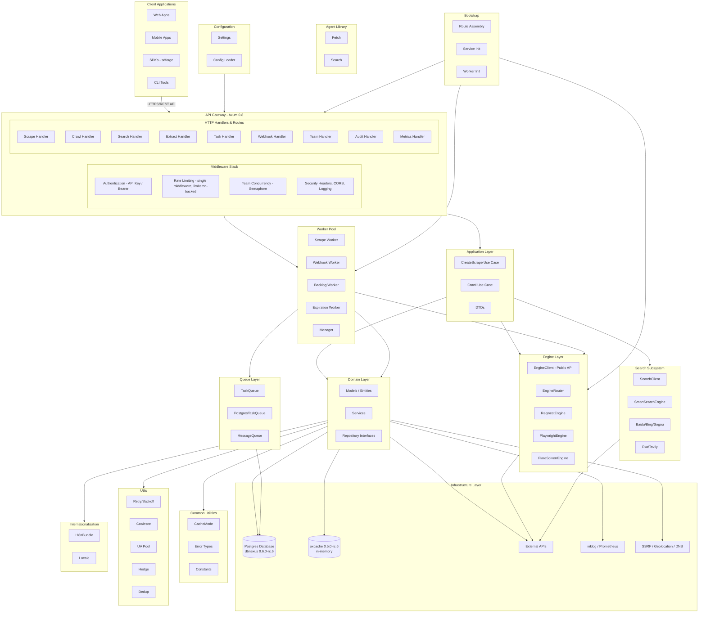
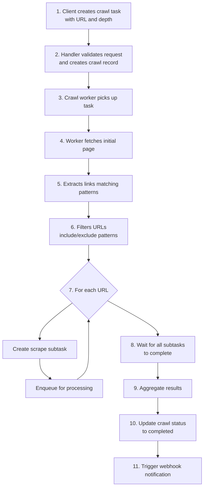
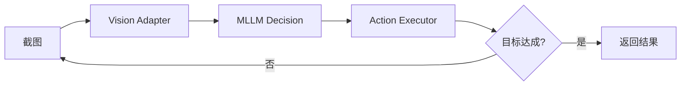
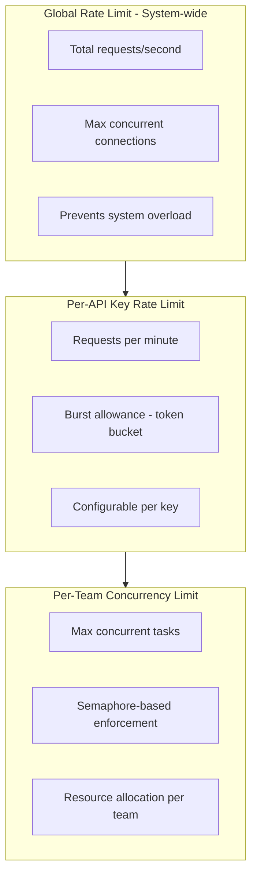
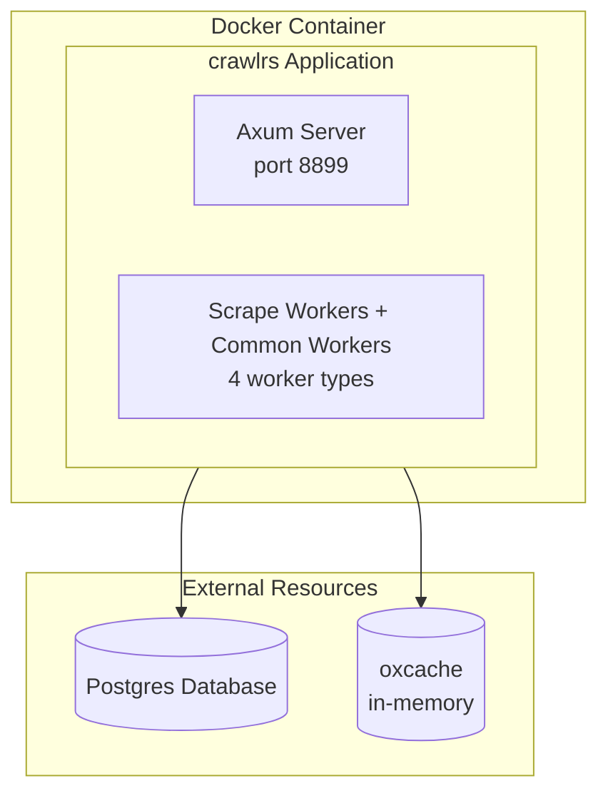
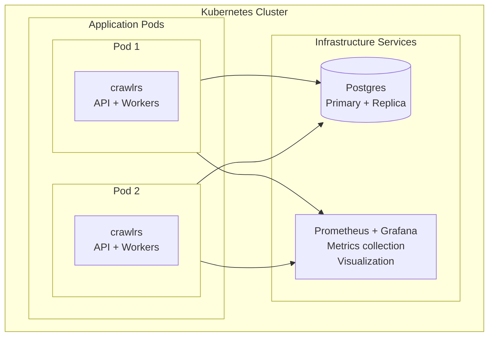
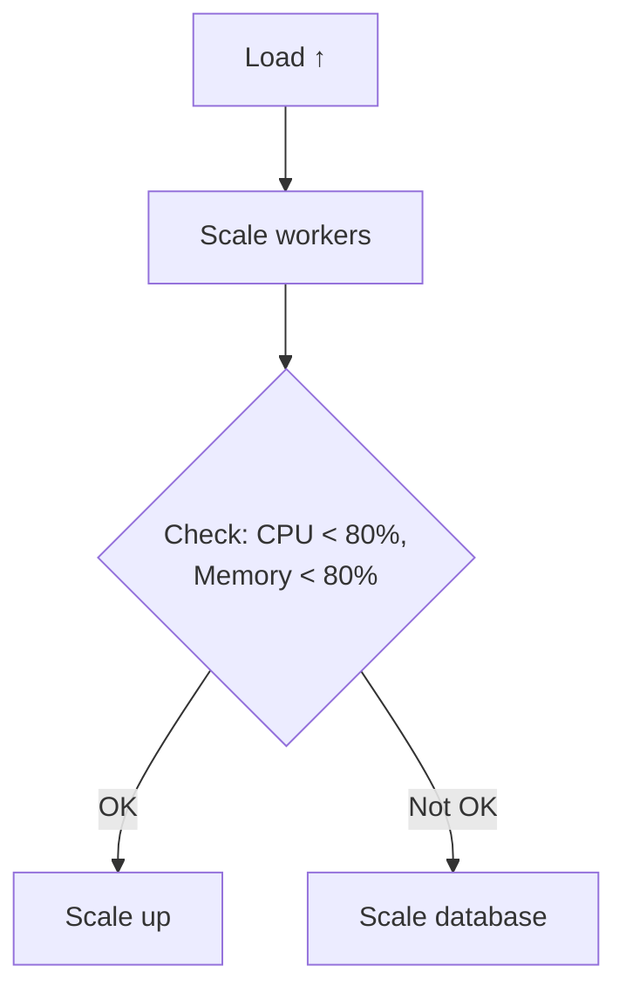

# 🏗️ Crawlrs Architecture

<div align="center">


**Version:** 0.2.0-rc.2 | **Last Updated:** 2026-10-15 | **Author:** Kirky.X

</div>

---

## 📋 目录

- [🧭 Overview](#-overview)
- [📐 Architectural Principles](#-architectural-principles)
- [🖥️ System Architecture](#️-system-architecture)
- [🧱 Layer Architecture](#-layer-architecture)
- [🧩 Core Components](#-core-components)
  - [Feature Gate Architecture](#feature-gate-architecture)
- [🔄 Data Flow](#-data-flow)
- [🕷️ Crawling Engines](#️-crawling-engines)
- [🚀 Crawl Capability Enhancement Modules](#-crawl-capability-enhancement-modules)
- [📬 Queue System](#-queue-system)
- [💾 Caching Strategy](#-caching-strategy)
- [⏱️ Rate Limiting](#️-rate-limiting)
- [🔁 自研库反向需求](#-自研库反向需求)
- [🔒 Security Model](#-security-model)
- [🚢 Deployment Architecture](#-deployment-architecture)
- [📈 Scalability Considerations](#-scalability-considerations)
- [🔮 Future Enhancements](#-future-enhancements)
- [📚 Documentation](#-documentation)
---

## 🧭 Overview

crawlrs is built using **Domain-Driven Design (DDD)** principles with a clean, layered architecture. The system is designed for high performance, scalability, and maintainability.

### Key Design Goals

1. **Performance** - 3-5x higher throughput than Node.js alternatives（设计目标，未经权威测量验证，详见 [PERFORMANCE.md](PERFORMANCE.md)）
2. **Scalability** - Horizontal scaling capabilities via stateless workers
3. **Type Safety** - Leverage Rust's type system for compile-time safety
4. **Flexibility** - Trait-based architecture for engines and extensions
5. **Observability** - Built-in metrics and inklog 0.3 structured logging via the `log::` facade

### Technology Stack

| Component | Technology | Version |
|-----------|-----------|---------|
| Async Runtime | Tokio | 1.53 |
| Web Framework | Axum | 0.8 |
| ORM | Sea-ORM (via dbnexus) | 2.0.4 |
| HTTP Client | Reqwest | 0.13 |
| Database | PostgreSQL | 16+ |
| Cache | oxcache (in-memory) | 0.5.0-rc.6 |
| Rate Limiting | limiteron | 0.3.0-rc.6 |
| DI Framework | trait-kit | 0.5.0-rc.7 |
| Config | confers | 0.6.0-rc.6 |
| SDK Generator | sdforge | 0.5.0-rc.6 |
| Logging | inklog | 0.3.0-rc.6 |
| Browser Engine | chromiumoxide | 0.9 |
| HTML Parser | scraper | 0.27 |

---

## 📐 Architectural Principles

### 1. Separation of Concerns

Each layer has a specific responsibility:
- **Presentation** - HTTP request/response handling, middleware
- **Application** - Use cases and business workflows, DTO mapping
- **Domain** - Core business logic and entities, repository interfaces
- **Infrastructure** - External integrations, database, cache, security

### 2. Dependency Inversion

High-level modules depend on abstractions (traits), not concrete implementations:

```rust
// Domain defines interface
trait TaskRepository: Send + Sync {
    async fn create(&self, task: &Task) -> Result<Task>;
    async fn find_by_id(&self, id: crate::domain::id::Id) -> Result<Option<Task>>;
    async fn acquire_next(&self, worker_id: crate::domain::id::Id) -> Result<Option<Task>>;
}

// Infrastructure provides implementation
struct TaskRepoImpl {
    db: Arc<DbPool>,
}

impl TaskRepository for TaskRepoImpl { ... }
```

### 3. Single Responsibility

Each component has one reason to change:
- `scrape_worker` - Only handles scrape task execution
- `webhook_worker` - Only handles webhook delivery
- `backlog_worker` - Only handles expired task cleanup
- `LimiteronService` - Only manages rate limits

### 4. Open/Closed Principle

System is open for extension, closed for modification:
- Add new scraping engines by implementing `ScraperEngine` trait
- Add new search engines by implementing `SearchEngine` trait
- Add new middleware by implementing `tower::Layer`

---

## 🖥️ System Architecture



---

## 🧱 Layer Architecture

### Presentation Layer

**Location:** `src/presentation/`

**Responsibilities:**
- HTTP request/response handling
- Request validation
- Response formatting
- Middleware implementation (auth, rate limiting, security)

**Components:**

```
presentation/
├── handlers/              # HTTP endpoint handlers
│   ├── scrape_handler.rs
│   ├── scrape_commands.rs
│   ├── scrape_queries.rs
│   ├── crawl_handler.rs
│   ├── crawl_commands.rs
│   ├── crawl_queries.rs
│   ├── search_handler.rs
│   ├── extract_handler.rs
│   ├── task_handler.rs
│   ├── task_commands.rs
│   ├── task_queries.rs
│   ├── webhook_handler.rs       #[cfg(feature = "webhook")]
│   ├── team_handler.rs          #[cfg(feature = "teams")]
│   ├── audit_handler.rs
│   ├── metrics_handler.rs
│   ├── api_key_handler.rs       #[cfg(feature = "auth")]
│   ├── map_handler.rs           #[cfg(feature = "sitemap")]
│   ├── response_builder.rs
│   └── mod.rs
├── forge_api/             # sdforge inventory 注册面（始终编译）
│   ├── mod.rs
│   ├── crawl.rs
│   ├── management.rs
│   ├── map.rs
│   ├── scrape.rs
│   ├── search.rs
│   └── task.rs
├── routes/                # Handler organization and unit-test assembly; route assembly in `src/bootstrap/routes.rs`
│   ├── mod.rs             # health, version, base routes
│   ├── handlers.rs        # Handler route registration
│   ├── scrape.rs
│   ├── crawl.rs
│   ├── extract.rs
│   └── task.rs
├── middleware/             # HTTP middleware
│   ├── auth_middleware.rs
│   ├── auth_bridge.rs
│   ├── auth_types.rs
│   ├── rate_limit_middleware.rs          # 唯一限流中间件（经 RateLimitingService trait 走 limiteron）
│   ├── security_headers_middleware.rs
│   ├── team_semaphore_middleware.rs
│   ├── scope_validation.rs
│   └── mod.rs
├── sdk/                   # sdforge SDK interface
│   ├── mod.rs
│   ├── mocks.rs
│   └── tests.rs
├── helpers/               # Shared helpers
│   ├── mod.rs
│   └── rate_limit_helper.rs
├── extractors/            # Request extractors
│   ├── mod.rs
│   └── app_deps.rs
├── errors.rs
├── state.rs
└── mod.rs
```

SSRF 校验实现不在 presentation 层：`src/infrastructure/security/ssrf/{mod,error,redirect,static_validator,types}.rs`。

**SDK Interface Layer (sdforge 0.5):**

The presentation layer includes an SDK interface built on **sdforge 0.5**, which wraps domain services as HTTP endpoints via sdforge's `#[forge]` macro. All SDK handlers extract authentication context from `AuthState` (populated by `auth_middleware`), never from the request body.

**Handler Flow:**

生产 handler 的依赖提取有两种真实形态。`scrape_commands::create_scrape` 经聚合提取器 `CrawlRsDeps`（`src/presentation/extractors/app_deps.rs:43`）一次性取常用依赖，地理限制与团队服务以 `Extension<Option<..>>` 注入（teams-off 时为 `None`），另需 `ConnectInfo` 取客户端 IP 做 SSRF 审计：

```rust
pub async fn create_scrape(
    CrawlRsDeps {
        queue,
        settings: _settings,
        task_repo: task_repository,
        rate_limiting_service,
        auth_state,
    }: CrawlRsDeps,
    // teams-off（Extension 未装配）时为 None，跳过检查
    Extension(geo_restriction_repo): Extension<Option<Arc<dyn GeoRestrictionRepository>>>,
    Extension(team_service): Extension<Option<Arc<TeamService>>>,
    ConnectInfo(addr): ConnectInfo<SocketAddr>,
    payload: Result<Json<ScrapeRequestDto>, axum::extract::rejection::JsonRejection>,
) -> impl IntoResponse
```

`extract_handler::extract`（`src/presentation/handlers/extract_handler.rs:54`）是少数直列 `Extension<...>` 的 handler，且带 `GR` 泛型由路由装配决定（teams-on 装配 `DatabaseGeoRestrictionRepository`，teams-off 用无泛型形式）：

```rust
pub async fn extract<GR>(
    Extension(queue): Extension<Arc<dyn TaskQueue>>,
    Extension(_settings): Extension<Arc<Settings>>,
    Extension(task_repository): Extension<Arc<dyn TaskRepository>>,
    Extension(rate_limiting_service): Extension<Arc<dyn RateLimitingService>>,
    Extension(geo_restriction_repo): Extension<Arc<GR>>,
    Extension(team_service): Extension<Arc<TeamService>>,
    Extension(auth_state): Extension<AuthState>,
    ConnectInfo(addr): ConnectInfo<SocketAddr>,
    // ...
) -> impl IntoResponse
```

**Middleware Stack:**

1. **Authentication Middleware** - API key validation, Bearer token, team ID extraction
2. **Security Headers Middleware** - CSP, X-Content-Type-Options, X-Frame-Options
3. **CORS** - Configurable origins via `tower-http`
4. **Rate Limiting** - 单一中间件 `rate_limit_middleware.rs`：实现本身只做 429 + `Retry-After` 判定与头部设置，实际速率判断与配额扣减经 `RateLimitingService` trait 委托给 `LimiteronService`（limiteron 0.3.0-rc.6，PostgreSQL 后端）。全仓无 Redis 依赖
5. **Team Semaphore Middleware** - Per-team concurrency control
6. **Scope Validation** - API key permission scope checking（未挂载生产路由）

---

### Application Layer

**Location:** `src/application/`

**Responsibilities:**
- Use case orchestration
- DTO definitions and transformations
- Business workflow coordination

**Components:**

```
application/
├── use_cases/             # Business use cases
│   ├── mod.rs
│   ├── create_scrape.rs
│   ├── crawl_use_case.rs
│   ├── crawl_link_processor.rs
│   ├── crawl_state_machine.rs
│   └── map_use_case.rs
└── dto/                   # Data Transfer Objects
    ├── mod.rs
    ├── scrape_request.rs
    ├── scrape_response.rs
    ├── crawl_request.rs
    ├── extract_request.rs
    ├── search_request.rs
    ├── task_query_request.rs
    ├── webhook_request.rs
    ├── geo_restriction_request.rs
    └── map_request.rs
```

**Use Case Pattern:**

```rust
pub struct CreateScrapeUseCase<R, Q, C> {
    task_repo: Arc<R>,
    queue: Arc<Q>,
    cache: Arc<C>,
}

impl<R, Q, C> CreateScrapeUseCase<R, Q, C>
where
    R: TaskRepository + Send + Sync,
    Q: TaskQueue + Send + Sync,
    C: CacheClient + Send + Sync,
{
    pub async fn execute(&self, request: ScrapeRequestDto) -> Result<ScrapeResponseDto> {
        // 1. Validate request
        // 2. Check rate limits
        // 3. Check cache
        // 4. Create task
        // 5. Enqueue
        // 6. Return response
    }
}
```

---

### Domain Layer

**Location:** `src/domain/`

**Responsibilities:**
- Core business entities
- Business rules and validation
- Repository interfaces (contracts)
- Domain services

**Components:**

```
domain/
├── models/                 # Domain entities
│   ├── mod.rs
│   ├── builders.rs
│   ├── task_domain.rs
│   ├── task_model.rs
│   ├── crawl_model.rs
│   ├── scrape_result_model.rs
│   ├── search_result.rs
│   ├── team_model.rs
│   ├── webhook_model.rs
│   ├── credits_model.rs
│   └── validations.rs
├── repositories/           # Repository interfaces
│   ├── mod.rs
│   ├── task_repository.rs
│   ├── crawl_repository.rs
│   ├── scrape_result_repository.rs
│   ├── webhook_repository.rs
│   ├── webhook_event_repository.rs
│   ├── team_repository.rs
│   ├── credits_repository.rs
│   ├── geo_restriction_repository.rs
│   ├── audit_log_repository.rs
│   └── tasks_backlog_repository.rs
├── services/               # Domain services
│   ├── mod.rs
│   ├── rate_limiting_service.rs
│   ├── extraction_service.rs
│   ├── extraction_utils.rs
│   ├── team_service.rs
│   ├── team_service_test.rs          # 内联测试（与实现同文件）
│   ├── team_semaphore.rs
│   ├── search_service.rs
│   ├── webhook_service.rs
│   ├── webhook_sender.rs
│   ├── webhook_event_builder.rs
│   ├── noop_webhook_service.rs
│   ├── audit_service.rs
│   ├── audit_log_builder.rs
│   ├── geo_location.rs
│   ├── id_service.rs                 # NebulaId ID 生成服务
│   ├── rag_strategy.rs               # RAG 语义分块 + 向量检索提取
│   ├── rerank.rs                     # 重排策略
│   ├── llm/                       # LLM 边界（mod: trait + ExplicitErrorCarrier；
│   │                              #  prompt_builder, chunker, provenance；
│   │                              #  vision_adapter 由 engine-mllm 门控）
│   ├── content_extractor/         # 正文提取（trafilatura/dom_smoothie/css_rule/quality_gate/facade）
│   ├── markdown_service.rs
│   ├── relevance_scorer.rs
│   ├── retry_handler.rs
│   ├── webhook/                  # Webhook 管理/领域逻辑（management, mod）
│   └── tests/                    # 领域服务独立测试目录
├── id/                     # NebulaId 域 ID 类型（Id / IdGenerator）
├── auth/                   # Authentication models
│   ├── mod.rs
│   └── scope.rs
├── errors.rs
├── use_cases/              # Domain use cases
│   ├── mod.rs
│   └── create_webhook.rs
├── retention_policy.rs     # Data retention policy definitions
```

**Core Domain Entities:**

**Task Entity:**
```rust
pub struct Task {
    pub id: crate::domain::id::Id,
    pub team_id: crate::domain::id::Id,
    pub api_key_id: crate::domain::id::Id,
    pub task_type: TaskType,
    pub status: TaskStatus,
    pub priority: i32,
    pub url: String,
    pub payload: Value,
    pub retry_count: i32,
    pub attempt_count: i32,
    pub max_retries: i32,
    pub scheduled_at: Option<DateTime<Utc>>,
    pub expires_at: Option<DateTime<Utc>>,
    pub created_at: DateTime<Utc>,
    pub started_at: Option<DateTime<Utc>>,
    pub completed_at: Option<DateTime<Utc>>,
    pub crawl_id: Option<crate::domain::id::Id>,
    pub updated_at: DateTime<Utc>,
    pub lock_token: Option<crate::domain::id::Id>,
    pub lock_expires_at: Option<DateTime<Utc>>,
}
```

所有 ID 字段均为 `crate::domain::id::Id`（NebulaId 域 ID 类型，`src/domain/id/`），不是旧式 UUID 值。

**Task Types:**
- `Scrape` - Single page scrape
- `Crawl` - Multi-page crawl
- `Extract` - Data extraction

**Task Statuses** (`src/domain/models/task_domain.rs:67-79`，五态):
- `queued` - Created, waiting for worker
- `active` - Being processed by worker（不是 `running`）
- `completed` - Successfully completed
- `failed` - Failed with error
- `cancelled` - Cancelled by user

注意：不存在 `Running` 与 `Expired` 变体。任务过期不改变状态取值，而是由 `expires_at` 字段 + `TaskRepository::expire_tasks()` 周期性清理完成；`Expired` 只作为 `tasks_backlog` 的 `TasksBacklogStatus` 存在（回灌队列的状态机，与 `tasks.status` 是两套枚举）。

---

### Infrastructure Layer

**Location:** `src/infrastructure/`

**Responsibilities:**
- External service implementations
- Database access (via dbnexus + Sea-ORM)
- Cache management (oxcache)
- Security (SSRF validation, API key hashing)
- DNS resolution and caching
- Geolocation
- Metrics and observability

**Components:**

```
infrastructure/
├── database/               # Database layer
│   ├── mod.rs
│   ├── dbnexus_connection.rs
│   ├── id_sea_orm.rs
│   ├── query_monitor.rs
│   ├── transaction.rs
│   ├── entities/           # Sea-ORM entity models
│   │   ├── mod.rs
│   │   ├── api_key.rs
│   │   ├── crawl.rs
│   │   ├── credits.rs
│   │   ├── credits_transactions.rs
│   │   ├── geo_restriction_log.rs
│   │   ├── scrape_result.rs
│   │   ├── sea_orm_active_enums.rs
│   │   ├── task.rs
│   │   ├── tasks_backlog.rs
│   │   ├── team.rs
│   │   ├── webhook.rs
│   │   ├── webhook_event.rs
│   │   └── auth/
│   │       ├── mod.rs
│   │       ├── audit_log.rs
│   │       └── scope.rs
│   └── repositories/       # Repository implementations
│       ├── mod.rs
│       ├── macros.rs
│       ├── task_repo_impl.rs
│       ├── crawl_repo_impl.rs
│       ├── scrape_result_repo_impl.rs
│       ├── credits_repo_impl.rs
│       ├── webhook_repo_impl.rs
│       ├── webhook_event_repo_impl.rs
│       ├── database_geo_restriction_repo.rs
│       ├── audit_log_repo_impl.rs
│       ├── tasks_backlog_repo_impl.rs
│       └── tests/               # Repository tests
│           ├── geo_restriction_cleanup_test.rs
│           ├── scrape_result_cleanup_test.rs
│           ├── task_repo_test.rs
│           └── webhook_event_cleanup_test.rs
├── oxcache/                # Unified cache (oxcache-backed)
│   ├── mod.rs
│   └── cache_service.rs
├── security/               # Security implementations
│   ├── mod.rs
│   ├── api_key_hash.rs
│   ├── constant_time_compare.rs
│   ├── env_var_security.rs
│   ├── env_injection.rs
│   ├── env_validation.rs
│   ├── secure_ip.rs
│   └── ssrf/               # SSRF 校验（mod, error, redirect, static_validator, types）
├── auth/                   # garrison 认证引擎 DAO 集成
│   ├── mod.rs              # garrison_config / garrison_dao / garrison_interface / garrison_listener
├── events/                 # 进程内事件总线
│   ├── mod.rs
│   ├── event_bus.rs        # EventBus trait
│   └── broadcast.rs        # BroadcastEventBus（tokio::sync::broadcast 实现）
├── persistence/            # Domain <-> DB entity mappers
│   ├── mod.rs
│   └── mappers/
│       ├── mod.rs
│       ├── task_mapper.rs
│       ├── crawl_mapper.rs
│       ├── credits_mapper.rs
│       └── webhook_mapper.rs
├── services/               # Infrastructure services
│   ├── mod.rs
│   ├── config_service.rs
│   ├── limiteron_service.rs
│   ├── noop_rate_limiting_service.rs
│   ├── http_rerank_provider.rs     # 远端 Rerank HTTP 适配（仅 reqwest，无需 feature）
│   ├── rig_embedding_provider.rs   # rag-remote：rig-core 远端嵌入
│   ├── vecboost_provider.rs        # rag-local：本地嵌入/重排（Candle CPU）
│   └── webhook_sender_impl.rs
├── dns/                    # DNS resolution + caching
│   ├── mod.rs
│   ├── dns_cache.rs
│   └── ipv4_resolver.rs
├── observability/          # Observability + 失败快照
│   ├── mod.rs
│   ├── metrics.rs
│   └── failure_snapshot.rs
├── geolocation.rs
├── metrics.rs
├── errors.rs
└── mod.rs
```

**Database Layer:**

**Technology:** dbnexus 0.6.0-rc.6 (builds on Sea-ORM 2.0.4)

dbnexus provides connection pooling, permission control, migration framework, metrics monitoring, and audit logging on top of Sea-ORM's type-safe database access. Three database backends are supported: PostgreSQL (default), SQLite, and MySQL — selectable via `db-postgres` / `db-sqlite` / `db-mysql` features.

**Key Tables:**

| Table | Purpose |
|-------|---------|
| `tasks` | Task records with locking for worker coordination |
| `tasks_backlog` | Backlog of expired/pending tasks for reprocessing |
| `crawls` | Crawl configurations (depth, patterns) |
| `scrape_results` | Scrape results (raw HTML, markdown, metadata) |
| `api_keys` | ⚠️ PARTIALLY DEPRECATED (0.2.0): `key_hash`/`scopes` 列由 garrison 接管，仅保留 `id`/`team_id`/`key` 列供 `api_key_id→team_id` 反查映射（`deprecated_at` 标记） |
| `webhooks` | Webhook configurations (URL, events, retry) |
| `webhook_events` | Webhook event logs and delivery status |
| `audit_logs` | API access and event audit logs (garrison `audit-log` 也写入此表) |
| `team` | Team accounts and settings |
| `credits` | Team credit balances |
| `credits_transactions` | Credit usage history |
| `geo_restriction_logs` | Geographic restriction check logs |
| `auth_scopes` | ⚠️ DEPRECATED (0.2.0): garrison RBAC 接管权限映射，本表不再写入（`deprecated_at` 标记，仅作历史审计只读） |

**Cache Layer:**

**Technology:** oxcache 0.5.0-rc.6 (in-memory, no Redis backend)

```rust
// Cache types
pub type SearchCache = Cache<String, Vec<SearchResult>>;
pub type DnsCache = Cache<String, DnsCacheEntry>;
pub type RegexCacheType = Cache<String, String>;
```

oxcache features activated（`Cargo.toml:316`）: `["memory", "serialization", "metrics", "bloom"]`。Type-specific TTL:
- Search cache: configurable (default 60s)
- DNS cache: configurable (default 300s)
- Regex cache: configurable (default 600s)

---

### Additional Top-Level Modules

**Location:** `src/queue/`, `src/search/`, `src/common/`, `src/utils/`, `src/agent_lib/`, `src/i18n/`, `src/config/`, `src/bootstrap/`

```
queue/                     # Task queue abstraction
├── mod.rs
├── message_queue.rs       # Message queue trait + implementations
├── postgres_message_queue.rs  # PostgreSQL-backed message queue
└── task_queue.rs          # TaskQueue trait + PostgresTaskQueue

search/                    # Search subsystem
├── mod.rs
├── client.rs              # SearchClient - multi-engine aggregation
├── client/
│   ├── baidu.rs           # Baidu search engine
│   ├── bing.rs            # Bing search engine
│   ├── exa.rs             # Exa search engine (API)
│   ├── sogou.rs           # Sogou search engine
│   ├── tavily.rs          # Tavily search engine (API)
│   ├── searxng.rs         # SearXNG adapter (public instance JSON API)
│   ├── html_parser.rs     # Shared Google-style HTML parser
│   └── shared_utils.rs    # Shared search utilities
├── dedup.rs               # ResultDeduplicator (SimHash)
├── engine_trait.rs        # SearchEngine trait
├── error.rs               # SearchError types
├── response.rs            # SearchResponse types
├── rrf.rs                 # RRFFuser (k=60)
├── smart/
│   └── mod.rs             # SmartSearchEngine (concurrent aggregation)
└── types.rs               # Search types

common/                    # Shared utilities
├── mod.rs
├── cache_mode.rs          # CacheMode enum + CacheContext
├── constants.rs           # Global constants
├── error.rs               # CrawlRsError types
├── http_method.rs         # HTTP method types
├── masking.rs             # Data masking utilities
├── metrics_shim.rs        # Metrics shim
├── test_fixtures.rs       # Test fixtures
├── test_helpers.rs        # Test helpers
├── text_slice.rs          # Text slice utilities
└── time_utils.rs          # Time utilities

utils/                     # Utility modules
├── mod.rs
├── adaptive_concurrency.rs # AIMD adaptive concurrency
├── backoff.rs              # Full-jitter backoff
├── coalesce.rs            # RequestCoalescer
├── crawl_text_integration.rs # Crawl text integration
├── dedup/
│   ├── mod.rs
│   ├── bloom.rs           # Bloom filter dedup
│   ├── deduplicator.rs    # Deduplicator trait
│   └── interner.rs        # String interner
├── error_helpers.rs       # Error helper utilities
├── glob.rs                # Glob pattern matching
├── hedge.rs               # Hedge request controller (EMA/P84)
├── host_discipline.rs     # Per-host politeness discipline
├── http_client.rs         # HTTP client utilities
├── port_sniffer.rs        # Port detection
├── proxy.rs               # Proxy utilities
├── regex_cache.rs         # Regex cache
├── retry/
│   ├── mod.rs
│   ├── directive.rs       # RetryDirective
│   └── tracker.rs         # RetryTracker
├── retry_after.rs         # Retry-After header parsing
├── retry_policy.rs        # Retry policy
├── robots.rs              # Robots.txt checker
├── search_test.rs         # Search test utilities
├── telemetry.rs            # Telemetry utilities
├── text_processing/
│   ├── mod.rs
│   ├── encoding.rs        # Text encoding
│   └── processor.rs       # Text processor
├── ua_pool.rs             # UA profile pool
├── url.rs                 # URL utilities
└── url_normalizer.rs      # URL normalization

agent_lib/                 # Agent library
├── mod.rs
├── error.rs               # Agent error types
├── fetch.rs               # Agent fetch utilities
└── search.rs              # Agent search utilities

i18n/                      # Internationalization
├── mod.rs
├── bundle.rs              # I18nBundle
├── locale.rs              # Locale handling
├── middleware.rs          # i18n middleware
└── translate.rs           # Translation utilities

config/                    # Configuration
├── mod.rs
├── app.rs                 # App config
├── engines.rs             # Engine config
├── llm.rs                 # LLM config
├── logging.rs             # Logging config
├── rag.rs                 # RAG config
├── runtime.rs             # Runtime config
├── search.rs              # Search config (incl. BingSearchSettings)
├── security.rs            # Security config
├── settings.rs            # Settings struct
└── validation.rs          # Config validation

bootstrap/                 # Application bootstrap
├── mod.rs
├── config/
│   ├── mod.rs
│   ├── config_loader.rs   # Config loading
│   └── config_validator.rs # Config validation
├── engines.rs             # Engine initialization
├── error.rs               # Bootstrap errors
├── infrastructure.rs      # Infrastructure initialization
├── routes.rs              # Route assembly (authoritative)
├── route_groups/
│   ├── mod.rs
│   ├── crawl_routes.rs    # Crawl route group
│   ├── management_routes.rs # Management route group
│   ├── map_routes.rs      # Map route group
│   ├── scrape_routes.rs   # Scrape route group
│   └── search_routes.rs   # Search route group
├── services.rs            # Service initialization
├── telemetry.rs           # Telemetry initialization
└── workers.rs             # Worker initialization
```

---

## 🧩 Core Components

### Dependency Injection (trait-kit 0.5.0-rc.7)

DI uses **trait-kit 0.5.0-rc.7** with async module builders. `src/main.rs:389-405` registers **9 个 Module** 到 `AsyncKit`：

| # | Module | 提供 |
|---|--------|------|
| 1 | `SettingsModule` | `Arc<Settings>`（含 i18n 解析后的配置） |
| 2 | `DatabaseModule` | dbnexus 连接池、迁移、权限 |
| 3 | `HttpModule` | `Arc<reqwest::Client>` |
| 4 | `CacheModule` | oxcache 缓存组件（search/dns/regex/generic） |
| 5 | `RepositoryModule` | 仓储组件（依赖 DatabaseModule） |
| 6 | `EngineModule` | 5 个引擎 + `EngineRouter` + `EngineClient`（依赖 HttpModule、SettingsModule） |
| 7 | `InfrastructureModule` | DB pool + 缓存服务等基础设施组件 |
| 8 | `ServiceModule` | 限流/搜索/webhook/团队服务 + 队列 + worker |
| 9 | `IdModule` | `IdService`（NebulaId ID 生成） |

`EngineModule` 提供 5 个引擎实现：`ReqwestEngine` / `PlaywrightEngine` / `WreqEngine`（`engine-tls-fingerprint`）/ `FlareSolverrEngine`（`engine-flaresolverr`）/ `MllmEngine`（`engine-mllm`）。

**CrawlRsState** 是运行时状态，由 `CrawlRsState::from_kit`（`src/di/axum_state.rs:207`）从构建完成的 kit 提取；它 require 5 个模块：`InfrastructureModule`、`EngineModule`、`ServiceModule`、`SettingsModule`、`IdModule`。自 v0.2.0（`feature-gate-optional-modules` change）起，有 7 个字段被 `#[cfg(feature = "...")]` 门控，仅在对应对业务特性启用时编译：

```rust
#[derive(Clone)]
pub struct CrawlRsState {
    pub db_pool: Arc<DbPool>,
    pub id_service: Arc<IdService>,
    pub task_repo: Arc<dyn TaskRepository>,
    pub credits_repo: Arc<dyn CreditsRepository>,
    pub crawl_repo: Arc<dyn CrawlRepository>,
    pub result_repo: Arc<dyn ScrapeResultRepository>,
    #[cfg(feature = "webhook")]
    pub webhook_repo: Arc<dyn WebhookRepository>,
    #[cfg(feature = "webhook")]
    pub webhook_event_repo: Arc<dyn WebhookEventRepository>,
    pub tasks_backlog_repo: Arc<dyn TasksBacklogRepository>,
    pub task_queue: Arc<dyn TaskQueue>,
    pub rate_limiting_service: Arc<dyn RateLimitingService>,
    #[cfg(feature = "teams")]
    pub team_service: Arc<TeamService>,
    // webhook_service 始终编译（trait），webhook-off 时装配 NoopWebhookService
    pub webhook_service: Arc<dyn WebhookService>,
    pub robots_checker: Arc<dyn RobotsCheckerTrait>,
    pub team_semaphore: Arc<TeamSemaphore>,
    pub request_coalescer: Arc<RequestCoalescer>,
    pub engine_router: Arc<EngineRouter>,
    pub engine_client: Arc<EngineClient>,
    pub create_scrape_use_case: Arc<dyn CreateScrapeUseCaseTrait>,
    pub search_client: Arc<SearchClient>,
    pub search_service: Arc<dyn SearchServiceTrait>,
    // 默认 ExplicitErrorCarrier；宿主经 pub 字段/工厂/from_kit 注入 carrier
    pub llm_service: Arc<dyn LLMServiceTrait>,
    pub extraction_service: Arc<dyn ExtractionServiceTrait>,
    // RAG：rag.enabled=false 或未配置时为 None（Option，非 cfg 门控）
    pub embedding_provider: Option<Arc<dyn EmbeddingProvider>>,
    pub rerank_provider: Option<Arc<dyn RerankProvider>>,
    pub content_extractor: Arc<ContentExtractionFacade>,
    pub cache_service: Arc<dyn CacheService>,
    pub audit_service: Arc<dyn AuditServiceTrait>,
    #[cfg(feature = "webhook")]
    pub webhook_worker: Arc<WebhookWorker>,
    pub backlog_worker: Arc<BacklogWorker>,
    pub expiration_worker: Arc<ExpirationWorker>,
    #[cfg(feature = "teams")]
    pub geo_location_service: Arc<dyn GeoLocationService>,
    #[cfg(feature = "teams")]
    pub geo_restriction_repo: Arc<dyn GeoRestrictionRepository>,
    pub i18n_bundle: Arc<I18nBundle>,
    pub event_bus: Arc<dyn EventBus>,
    #[cfg(feature = "sitemap")]
    pub map_use_case: Arc<MapUseCase>,
}
```

`regex_cache` 已不在 `CrawlRsState` 上（无此字段）。默认构建（platform，含 teams/sitemap）下共 **36 个字段**：29 个恒定编译 + 7 个 cfg 门控（`webhook_repo`/`webhook_event_repo`/`webhook_worker` 受 `webhook`，`team_service`/`geo_location_service`/`geo_restriction_repo` 受 `teams`，`map_use_case` 受 `sitemap`）。字段数以 `src/di/axum_state.rs:70-193` 为准。

| Field | Gated By | Off-mode Behavior |
|-------|----------|-------------------|
| `webhook_repo` / `webhook_event_repo` / `webhook_worker` | `webhook` | Field not compiled; `/v1/webhooks/*` routes not registered; `webhook_worker` spawn block skipped |
| `team_service` / `geo_location_service` / `geo_restriction_repo` | `teams` | Field not compiled; `/v1/teams/*` routes not registered; `extract_handler` signature loses GR generic |
| `map_use_case` | `sitemap` | Field not compiled; `/v1/map` route not registered (sitemap 流式站点图) |
| `webhook_service` | (none, always compiled) | webhook-off: assembled with `NoopWebhookService` (no-op trait impl) |
| `rate_limiting_service` | (none, always compiled) | rate-limit-off: assembled with `NoopRateLimitingService` (always-allow trait impl) |
| `embedding_provider` / `rerank_provider` | (none, `Option`) | rag 未启用或未配置时为 `None`，非 cfg 门控 |

See [Feature Gate Architecture](#feature-gate-architecture) for the full gating matrix.

State is injected into Axum handlers via `Extension<CrawlRsState>`.

**Module dependency graph**（`src/main.rs:389-405` 的注册顺序即依赖顺序；`CrawlRsState::from_kit` require 其中 5 个）：

```text
SettingsModule (Arc<Settings> + i18n 配置)
  ├── DatabaseModule → dbnexus pool（迁移/权限）
  ├── HttpModule → Arc<reqwest::Client>
  └── CacheModule → oxcache 缓存组件
         ├── RepositoryModule → Repositories（依赖 DatabaseModule）
         ├── InfrastructureModule → 基础设施组件（DB pool、CacheService 等）
         │     └── ServiceModule → ServicesComponents（依赖 RepositoryModule、EngineModule）
         ├── EngineModule → EngineComponents（依赖 HttpModule、SettingsModule）
         │     └── ServiceModule
         └── IdModule → Arc<IdService>（NebulaId ID 生成）
```

`CrawlRsState::from_kit` 提取 `InfrastructureModule`、`EngineModule`、`ServiceModule`、`SettingsModule`、`IdModule` 五个模块的组件并拍平为扁平字段。

### Feature Gate Architecture

Since v0.2.0 (`feature-gate-optional-modules` change), crawlrs exposes **6 feature axes** that allow operators to build stripped-down binaries for single-tenant / no-auth / no-webhook / no-rate-limit deployments, plus auth-off web assembly and SDK inventory registration. The gating strategy follows two complementary patterns:

1. **Field/module gating** (`#[cfg(feature = "...")]` on `pub mod`/struct field/fn) — gated symbols are **not compiled** when the feature is off, eliminating dead code and reducing binary size.
2. **Noop trait injection** — for traits that business logic calls unconditionally (`WebhookService`, `RateLimitingService`), the trait is always compiled but the DI container assembles a no-op implementation when the feature is off, preserving call-site compatibility.

### Feature Matrix

| Feature | Default | Depends On | Off-mode Behavior |
|---------|---------|------------|-------------------|
| `teams` | on | `auth` | `/v1/teams/*` routes not registered; `extract_handler` loses GR generic + geo-restriction block; `CrawlRsState.{team_service, geo_location_service, geo_restriction_repo}` not compiled; `team_id` falls back to `DEFAULT_TEAM_ID` |
| `auth` | on | `dep:garrison, dep:inventory` | **0.2.0 起 garrison v0.9.0-rc.2 接管认证**：`auth_middleware_inner` 调用 `GarrisonUtil::check_api_key` + `bridge_to_auth_state` 注入 `AuthState`；提供 RBAC + JWT + firewall-bruteforce（5 次/60 秒/300 秒锁定）+ audit-log。关闭时改为 `default_identity_middleware` 注入固定 `AuthState{team_id=DEFAULT_TEAM_ID, api_key_id=DEFAULT_API_KEY_ID, scope=ApiKeyScope::denied()}`，无 DB 查询、无暴力破解防护；受保护路由默认 401，放行须经 `allow_unauthenticated_protected()` 显式 opt-in（放行后仍是 denied 受限身份） |
| `rate-limit` | on | —（空数组） | `LimiteronService` replaced by `NoopRateLimitingService` (check_rate_limit→Allowed, check_and_deduct_quota→Ok, get_quota_balance→Ok(i64::MAX), process_backlog_tasks→Ok(0)); `rate-limit` 只门控装配选择，`limiteron` crate 因 `utils/backoff` 无条件依赖其 retry 原语而始终编译，`rate_limit_middleware` 始终挂载（内部 trait 调用 no-op 实现） |
| `webhook` | on | — | `WebhookServiceImpl`/`WebhookManagementServiceImpl`/`webhook_sender`/`webhook_handler`/`webhook_worker` modules not compiled; `/v1/webhooks/*` routes not registered; `webhook_worker` spawn blocks skipped; `WebhookService` trait preserved and assembled with `NoopWebhookService` (all ops return `Ok(())`) |
| `web-axum` | off | `rate-limit`, `webhook`, `metrics`, `content`, `dbnexus`, `axum` | auth-off Web 中间件构建面（platform 隐含 auth 导致原矩阵中该路径不可构建）；`--no-default-features --features web-axum,db-postgres --lib` 构建/测试 auth-off 语义 |
| `forge-full` | off | `http` | 激活 `presentation/forge_api` 的 sdforge inventory 注册面；与手写 protected/v2 路由组互斥（并存即启动 panic） |

### Default feature set

```toml
[features]
default = ["platform", "db-postgres"]
# platform：完整平台服务能力面。sitemap 是 platform 的组成部分（0.2.0 起）
platform = ["teams", "auth", "rate-limit", "webhook", "metrics", "content", "sitemap",
            "dep:dbnexus", "dep:axum", "http"]
teams   = ["auth"]
auth    = ["dep:garrison", "dep:inventory"]   # 0.2.0: garrison v0.9.0-rc.2 接管认证引擎
rate-limit = []            # 空数组：只门控装配选择，limiteron crate 始终编译
webhook = []
full    = ["standard", "engine-flaresolverr", "extractors", "llm"]
llm     = []                # trait + 编排 + ExplicitErrorCarrier，零外部依赖
engine-mllm = ["engine-playwright", "llm", "dep:genai"]  # genai 仅随视觉面保留

# sitemap（0.2.0 起并入 platform）：
sitemap = ["dep:quick-xml"]
```

`rate-limit = []` 的原因：`utils/backoff` 的重试原语无条件依赖 `limiteron` crate，故该依赖不随 feature 关闭而摘除；feature 关闭只把 `RateLimitingService` 的装配从 `LimiteronService` 换成 `NoopRateLimitingService`。同理 `teams` 隐含 `auth`，`auth` 隐含 `dep:garrison` + `dep:inventory`。

### Gating pattern examples

**Field gating** (`src/di/axum_state.rs`):

```rust
#[cfg(feature = "webhook")]
pub webhook_repo: Arc<dyn WebhookRepository>,
```

**Noop injection** (`src/bootstrap/services.rs::init_rate_limiting_service`):

```rust
#[cfg(feature = "rate-limit")]
{ /* assemble LimiteronService */ }
#[cfg(not(feature = "rate-limit"))]
{
    log::warn!("rate-limit feature disabled, using NoopRateLimitingService");
    Arc::new(NoopRateLimitingService::new())
}
```

**Route gating with shadowing** (`src/bootstrap/routes.rs`):

```rust
#[cfg(feature = "webhook")]
let app = app.route("/v1/webhooks", post(webhook_handler::create_webhook::<WebhookRepoImpl>));
// webhook-off: route not registered, returns 404
```

**Middleware layer gating** (`src/bootstrap/routes.rs`):

```rust
#[cfg(feature = "auth")]
let app = app.layer(axum::middleware::from_fn(auth_middleware::auth_middleware()));
#[cfg(not(feature = "auth"))]
let app = {
    let template = build_default_identity_template(state);
    app.layer(axum::middleware::from_fn_with_state(
        template,
        auth_middleware::default_identity_middleware,
    ))
};
```

### CI verification

The `feature-matrix` job in `.github/workflows/ci.yml` runs `cargo check` against 7 feature combinations to ensure no broken cfg paths slip in:

| Combination | Flags |
|-------------|-------|
| no-default | `--no-default-features` |
| teams-only | `--no-default-features --features teams` |
| auth-only | `--no-default-features --features auth` |
| rate-limit-only | `--no-default-features --features rate-limit` |
| webhook-only | `--no-default-features --features webhook` |
| default | `--features default` |
| full | `--features full` |

### Migration notes

When a feature is off, the corresponding endpoints return **404** (not 401/403) because routes are not registered at startup. Operators switching from full to stripped-down builds should:

- For `auth`-off: pre-provision credits for `DEFAULT_TEAM_ID` via `add_credits` CLI (see `docs/USER_GUIDE.md` → Single-Tenant / No-Auth Deployment)
- For `rate-limit`-off: ensure upstream gateways enforce their own rate limiting
- For `webhook`-off: notify clients that completion callbacks will not be delivered
- For `teams`-off: only `DEFAULT_TEAM_ID` exists; multi-tenant data isolation is enforced at the application layer (all rows owned by `DEFAULT_TEAM_ID`)

### Configuration Hierarchy

**Location:** `config/default.toml` (confers 0.6.0-rc.6)

```toml
[database]              # Connection pool, timeouts, prepare-cache
[server]                # Host, port, enable_port_detection
[cors]                  # Allowed origins
[rate_limiting]         # Enabled, default_rpm, burst_size, storage_backend
[cache]                 # Enabled, memory capacity/TTL
[cache.memory]          # Moka L1 capacity + TTL
[cache.types.search]    # Search result cache TTL + max_size
[cache.types.dns]       # DNS cache TTL + max_size
[cache.types.regex]     # Regex cache TTL + max_size
[concurrency]           # Team limits, memory pressure, AIMD
[politeness]            # Per-host min/max interval, AutoThrottle, backoff, jitter
[retention]             # Data retention (scrape_results_days)
[search]                # Timeout, rate limiting, max_results, default_engine
[search.engines]        # Per-engine enable switches (bing/baidu/sogou)
[search.fallback]       # Fallback engine order + API keys
[search.fallback.exa]   # Exa API key + endpoint
[search.fallback.parallel] # Parallel API key + endpoint
[search.fallback.tavily]   # Tavily API key + endpoint
[search.exa]            # Exa single-engine credentials
[search.tavily]         # Tavily single-engine credentials
[search.searxng]        # SearXNG opt-in: enabled/pool_target/max_failover_attempts/seed_urls/user_agent
[search.searxng.collector] # Dataset url/timeouts/min_uptime_day/retire_miss_cycles
[search.searxng.health]    # Probe interval/timeout/query/candidate_batch/failure_retire_threshold
[search.searxng.breaker]   # Per-instance breaker threshold/recovery_timeout_seconds
[engines]               # max_response_body_bytes
[engines.playwright]     # XHR/Fetch capture settings
[engines.flaresolverr]  # FlareSolverr Full mode
[engines.flaresolverr_cdp] # FlareSolverr CDP mode
[engines.flaresolverr_tls] # FlareSolverr TLS mode
[engines.tls_fingerprint]  # Wreq TLS fingerprint (feature-gated)
[engines.mllm]          # MLLM autonomous navigation (feature-gated)
[webhook]               # Secret, max_retries, batch_size
[bing_search]           # Bing Search API key (via env var)
[llm]                   # model, timeout, provenance（供应商访问已移交宿主 carrier）
[llm.chunking]          # Token window chunking settings
[content_extraction]    # Min word count, replacement ratio, prose gates
[rag]                   # Embedding + rerank providers, local/remote settings
[proxy]                 # URLs, strategy, sticky TTL, cooldown
[session]               # Session identity pool (proxy + UA/TLS + cookie)
[workers]               # Count, graceful shutdown, dedup warmup
[sitemap]               # Enabled, max_urls, concurrency, channel capacity
[crawl]                 # Soft 404 fingerprint learning
[timeouts.workers]      # Webhook/backlog intervals
[timeouts.engines]      # Default/playwright/flaresolverr timeouts + MRT
[timeouts.retry]        # Initial/max backoff
[timeouts.cache]        # Default/memory TTL
[logging]               # Console + file output settings
[observability]         # Failure snapshot directory + limits
[trusted_proxies]       # Enabled, proxy IP list (CIDR)
[auth]                  # JWT secret (garrison)
[robots]                # User-agent, scrape respect, fail-closed, cache TTL
[i18n]                  # Default locale, supported locales, locales dir
[id]                    # NebulaId algorithm, workspace, group
```

---

## 🔄 Data Flow

### Scrape Request Flow

```mermaid
flowchart TD
    A[1. Client Request] --> B[2. API Gateway<br/>Authentication<br/>Rate Limit<br/>SSRF Check]
    B --> C[3. Handler<br/>Validation<br/>DTO Mapping]
    C --> D[4. Use Case<br/>Business Logic]
    D --> E[5. Repository<br/>Task Creation]
    E --> F[6. Task Queue<br/>enqueue]
    F --> G[7. Scrape Worker<br/>dequeue + process]
    G --> H{8. Engine Selection}
    H --> H1[ReqwestEngine]
    H --> H2[PlaywrightEngine<br/>(if needs_js)]
    H --> H3[FlareSolverrEngine<br/>(if anti-bot)]
    H1 --> I[9. Result Storage<br/>oxcache + DB]
    H2 --> I
    H3 --> I
    I --> J[10. Task Update<br/>Status = Completed]
    J --> K[11. Webhook Notification<br/>Async]
    K --> L[12. Client Response<br/>Poll/Webhook]
```

### Crawl Request Flow



---

## 🕷️ Crawling Engines

### Engine Architecture

The engine layer is organized around three core abstractions: `ScraperEngine` trait, `EngineRouter` with load balancing, and `EngineClient` as the public API.

**EngineClient** (`src/engines/engine_client.rs`) is the single public entry point for all scraping operations. It encapsulates UA rotation, circuit breaker state, engine selection, and retry logic.

**ScraperEngine Trait:**

```rust
#[async_trait]
pub trait ScraperEngine: Send + Sync {
    async fn scrape(
        &self,
        request: &InternalScrapeRequest,
    ) -> Result<InternalScrapeResponse, EngineError>;

    fn support_score(&self, request: &InternalScrapeRequest) -> u8;

    fn name(&self) -> &'static str;

    fn supports_tls_fingerprint(&self) -> bool {
        false
    }

    fn max_response_time(&self) -> Duration {
        Duration::from_secs(30)
    }
}
```

### Engine Router

The `EngineRouter` (`src/engines/router/mod.rs`，目录实现) holds a `Vec<Arc<dyn ScraperEngine>>` and selects engines. The internal strategy field 在 `EngineRouter::new` 中是**硬编码默认** `LoadBalancingStrategy::SmartHybrid`——settings 侧没有可配置入口，生产装配不调用 setter（`set_strategy` 等 setter 存在但仅在测试中使用）：

```rust
// src/engines/router/mod.rs:79,86-186
pub enum LoadBalancingStrategy {
    RoundRobin,
    WeightedRoundRobin,
    LeastConnections,
    FastestResponse,
    Random,
    SmartHybrid,  // hard-coded default — not settable via config
}
```

其余内部参数同样为构造期常量：`max_engine_attempts = 3`、`max_retries = 5`、`race_mode_enabled = false`（顺序回退为默认模式，竞速模式为显式启用）、`feature_filter_enabled = true`、`dynamic_threshold_factor = 1.0`。

`src/engines/router/` 目录内含四个文件：`mod.rs`（路由器主体）、`engine_selector.rs`（同步候选引擎过滤）、`route_race.rs`（并发竞速）、`route_sequential.rs`（顺序回退）。

The router:
1. Filters engines by `support_score` (feature-based filtering，同步过滤在 `engine_selector.rs`)
2. Applies the load balancing strategy（`SmartHybrid`，构造期硬编码）
3. Falls back to sequential engines on failure (`route_sequential.rs`)
4. Supports race mode (concurrent execution, return first success, `route_race.rs`)
5. race mode 胜出后调用 `hedge_controller.record_latency(response_time)` 更新 EMA/方差，用于后续 P84 阈值估算（详见 [Hedge 请求副本控制器](#hedge-请求副本控制器)）

### Hedge 请求副本控制器

<a id="hedge-请求副本控制器"></a>

**Location:** `src/utils/hedge.rs`

**背景（design.md §17）：** 移植 spider `hedge.rs`，基于 EMA（指数移动平均）+ 方差估算 P84 延迟阈值，超阈值时建议发送副本请求降尾延迟。

**核心算法：**

- EMA：`EMA_new = α·x + (1-α)·EMA_old`
- 方差：`Var_new = (1-α)·Var_old + α·(x-EMA_new)·(x-EMA_old)`（指数加权移动方差，递推式）
- P84 阈值：`P84 = EMA + σ_multiplier · sqrt(Var)`（标准正态分布 P84 ≈ μ+σ）

**并发模型：** 使用 `parking_lot::Mutex<HedgeState>` 保护 `(ema, var, sample_count)` 三元组原子更新。非热路径（race 胜出后单次记录），Mutex 开销相对 race 100ms+ 网络耗时占比 < 0.0001%。

**接入路径：**

```rust
// EngineRouter::route_race_mode 胜出后记录延迟
Ok((engine_name, response, response_time)) => {
    self.hedge_controller.record_latency(response_time);
    Ok(response)
}

// 顺序路径未来可调用 should_hedge 决策副本触发
if router.hedge_controller().should_hedge(elapsed) {
    // 发送副本请求...
}
```

**样本来源限制（M-2）：** 当前 `record_latency` 仅在 race 胜出后调用，记录 `min(各引擎延迟)` 分布。**不可直接用于顺序路径 P84 估算**（顺序路径是单引擎全延迟，分布完全不同，复用会导致阈值系统性偏低）。顺序路径接入时需独立的 HedgeController 实例。

### WaitFor 策略

<a id="waitfor-策略"></a>

**Location:** 枚举定义在 `src/engines/engine_client.rs`，实现在 `src/engines/wait.rs`（`engine-playwright` feature 门控）

**背景（design.md §17）：** 替代原有 `sync_wait_ms` 固定 sleep，提供条件式等待：满足条件立即返回，超时返回错误，避免无谓阻塞。

```rust
pub enum WaitFor {
    NetworkIdle,           // 等待网络空闲（无新请求持续 500ms）
    Selector(String),      // 等待指定 CSS selector 出现在 DOM 中
    DomStable(Duration),   // 等待 DOM 稳定（无变化持续指定时长，上限 60s）
}
```

**接入路径：** `InternalScrapeRequest.wait_for: Option<WaitFor>` 字段，Playwright 引擎在 `goto` 后调用 `request.wait_for.unwrap_or_default().wait(&page, timeout)`。

**桥接实现：** API DTO 层 `ScrapeRequestOptions.wait_for: Option<u64>`（毫秒）在 `create_scrape` use case 中映射为 `WaitFor::DomStable(Duration::from_millis(ms))`，并钳制到 10s（引擎侧 `WAIT_TIMEOUT_CAP`），防合法输入触发 DomStable 超预算确定性失败（`src/application/use_cases/create_scrape.rs:126-130`）。

### TabPool 浏览器 Tab 复用

<a id="tabpool-浏览器-tab-复用"></a>

**Location:** `src/engines/client/tab_pool.rs`

**背景（design.md §17）：** Playwright 引擎每次抓取创建新 Tab 开销大（CDP `Target.createTarget` + `Page.goto`，约 50-200ms），TabPool 在 BrowserPool 之上进一步复用 Page，消除 tab 创建开销。

**实现：** 基于 `DashMap<usize, Page>` + `AtomicUsize` 栈顶指针的 LIFO 无锁栈：

```rust
pub struct TabPool {
    slots: DashMap<usize, Page>,  // slot 索引 → Page
    head: AtomicUsize,           // 单调递增的栈顶指针
    max_size: usize,             // 最大池容量
}
```

**acquire/release 流程：**

- `acquire(&browser)`: 原子递减 `head` 取栈顶 Page；池空时调用 `browser.new_page("about:blank")` 新建。
- `release(page)`: 先将 Page 导航到 `about:blank` 清理状态（5s 超时，超时则 drop 关闭 tab），再压回栈；池满（`head >= max_size`）则直接 drop。

**多 Browser 安全：** TabPool 不绑定特定 Browser，`acquire` 接受 `&Browser` 参数。池空时用传入的 Browser 新建 Page；池非空时弹出的 Page 可能属于其他 Browser。调用方应保证 TabPool 生命周期与单个 Browser 一致（per-Browser 实例化），或在多 Browser 场景下由上层 `BrowserPool` 按 instance_id 路由。

### Page Action Types

```rust
pub enum PageAction {
    Wait { milliseconds: u64 },
    Click { selector: String },
    Scroll { direction: ScrollDirection },
    Input { selector: String, text: String },
}
```

### Engine Types

#### 1. Reqwest Engine

**Use Cases:**
- Static HTML pages
- API responses
- JSON/XML data
- Fast scraping without JS

**Features:**
- HTTP/2 support via rustls
- TLS 1.2/1.3
- Cookie handling
- Custom headers and proxy support
- Gzip/brotli decompression

**Pros:**
- Fastest performance
- Lowest resource usage
- No browser overhead

**Cons:**
- No JavaScript execution
- Limited dynamic content support

#### 2. Playwright Engine (via chromiumoxide 0.9)

**Use Cases:**
- Single Page Applications (SPAs)
- JavaScript-heavy sites
- Sites requiring interactions
- Screenshots

**Features:**
- Full JavaScript execution via Chrome DevTools Protocol
- Page interactions (click, scroll, input)
- Screenshots
- Network interception

**Pros:**
- Full browser capabilities
- Renders dynamic content
- Can handle complex interactions

**Cons:**
- Higher resource usage
- Slower than HTTP client
- Requires Chromium installation

#### 3. FlareSolverr Engine

FlareSolverr merges the original three fire engines (FlareSolverrEngine, FireEngineCdp, FireEngineTls) into a single engine with mode selection:

```rust
pub enum FlareSolverrMode {
    Full,  // Full mode: JS rendering, session mgmt, CAPTCHA detection, screenshots
    Cdp,   // CDP mode: browser automation, TLS fingerprinting
    Tls,   // TLS mode: TLS fingerprinting only, no screenshots
}
```

All three modes share the same FlareSolverr API client implementation, differing only in `support_score` and `name`:

| Mode | `name()` | `supports_tls_fingerprint()` | Screenshots |
|------|----------|------------------------------|-------------|
| Full | `flaresolverr` | No | Yes |
| Cdp | `flaresolverr_cdp` | Yes | Yes |
| Tls | `flaresolverr_tls` | Yes | Rejected |

**Use Cases:**
- Cloudflare-protected sites
- Anti-bot protected sites
- High-anonymity requirements
- Search engine CAPTCHA bypass

**Features (by mode):**
- Full: JS rendering, session management, CAPTCHA detection
- Cdp: TLS fingerprinting, browser automation, CDP protocol
- Tls: TLS fingerprint adversarial, fast execution, no screenshot

---

### Search Subsystem

**Location:** `src/search/`

**职责分层：**

- **smart 层** (`src/search/smart/mod.rs`)：`SmartSearchEngine` 并发聚合——`tokio::join!` 同时查询 Baidu/Bing/Sogou 三引擎，经 SimHash 去重（`ResultDeduplicator`）→ RRF 融合（`RRFFuser`，k=60）→ `RelevanceScorer`（TF-IDF + 新鲜度）评分排序；单引擎 fan-out 超时按失败降级（部分结果容忍），出站 per-engine 最小间隔 gate 防止触发搜索引擎封禁
- **client 层** (`src/search/client/{baidu,bing,exa,sogou,tavily,searxng}.rs`)：各引擎实现（HTML 解析、URL 提取、XSS 防护、CSS 选择器管理），`html_parser.rs` 提供共享的 Google 风格 `HtmlParser`（`once_cell::sync::Lazy` 全局单例，避免重复编译 CSS 选择器）；`searxng.rs` 是公共实例 JSON API 适配器（实例从实例服务端口获取，不直连 DB）

#### SearXNG 实例生命周期

`search.searxng.enabled = true` 时启用（默认关闭）。登记簿 `searxng_instances` 是唯一共享真相，进程内热池只是缓存：

```mermaid
flowchart LR
    DS[searx.space<br/>instances.json] -->|采集轮<br/>advisory lock 防重| C[准入谓词<br/>HTTPS / 非内网 / normal / uptime]
    C -->|upsert 幂等| REG[(searxng_instances)]
    SEED[seed_urls] -->|upsert_seed| REG
    REG -->|候选/冷却| PROBE[探活<br/>GET /search?format=json]
    PROBE -->|200 + results[]| POOL[热池<br/>target=3]
    PROBE -->|失败| CD[cooldown]
    CD -->|连续失败达阈值| RET[retired]
    POOL -->|搜索请求失败| CB[熔断 searxng:url]
    CB -->|逐出 + 异步晋升| PROBE
    POOL --> SE[引擎/搜索路径]
```

- **采集**：周期拉取 `collector.data_url` → 宽容 serde（全字段可缺）→ 准入谓词 → 幂等 upsert；缺席数据集的 `searx_space` 实例累计 `dataset_miss_count`，超 `retire_miss_cycles` 转 `retired`（`seed` 来源永不因缺席退役）
- **探活**：热池全体 + 冷却期满的 `cooldown` + 前 `candidate_batch` 个候选，按状态机 `candidate → active → cooldown → retired` 迁移（`retired` 重新出现在数据集并探活通过可回 `active`）
- **熔断与故障切换**：专属 `CircuitBreaker` 实例（键 `searxng:<url>`），失败达阈值/熔断开 → 逐出 + 转 `cooldown` → 异步探测替补回池；单次搜索最多换 `max_failover_attempts` 个实例
- **降级口径**：池满 `Healthy`、非空不足 `Degraded`（+warn）、空 `Unhealthy`；「3 实例」是控制回路目标，非对外部第三方的硬保证
- **管理 API**：`GET /v1/searxng/instances` / `GET /v1/searxng/pool` / `POST /v1/searxng/instances/collect`（auth 保护组，见 `src/presentation/handlers/searxng_handler.rs`）

---

## 🚀 Crawl Capability Enhancement Modules

> 以下模块由 `crawler-capability-absorption` 变更引入（0.2.0）。

### Anti-bot Detection (`src/engines/antibot/`)

三层分类器移植自 crawl4ai `antibot_detector.py`，gated `antibot` 特性：

- `patterns.rs`：Tier1（20+ WAF 结构标记：Cloudflare/Akamai/PerimeterX/DataDome 等）+ Tier2（通用词字面量集，构建 `aho_corasick::AhoCorasick`）+ Tier3 结构正则
- `classifier.rs`：`AntiBotTech` 枚举 + `Detection{tech,reason,needs_browser}` + `classify(status,body,headers,url)->Option<Detection>`
- 路由集成：`EngineRouter::route_internal` 在引擎成功分支调用 `classify`，命中 `needs_browser` 时强制后续 attempt `needs_js=true` 改派浏览器引擎

### HTTP→Chrome Upgrade Probe (`src/engines/upgrade_probe.rs`)

`JsUpgradeProbe` 通过强/弱信号评分探测 SPA 空壳：

- 强信号（score+=10）：`__NUXT_DATA__`/`__NEXT_DATA__`/`window.__INITIAL_STATE__`/空 root+hydration
- 弱信号（score+=1）：非追踪 `<script src>`（排除 ga/gtm/analytics/pixel）
- `score>=threshold` 时 `EngineRouter` 以 `needs_js=true` 重新改派 Playwright

### Memory-aware Scheduler (`src/workers/scheduler/`)

- `memory_scheduler.rs`：`MemoryState{Normal,Pressure,Critical}` + `MemoryScheduler` 复用 `SystemMonitorTrait`，`admit()` 返回 `Admission::{Proceed,Defer,Reschedule}`
- `priority_queue.rs`：`BinaryHeap<ScheduledTask>` 按 `effective_priority = base + waited_secs/aging_factor` 排序，防饿死
- 接入 `scrape_worker::process_task`：获取并发许可前调用 `admit()`

### UA Pool (`src/utils/ua_pool.rs`)

`UaProfile{ua,accept_language,sec_ch_ua,platform,viewport,mobile}` + `UaPool{desktop,mobile}`：

- 内置 20+ 桌面 + 移动真实 profile，每 profile 绑定一致的 UA/Accept-Language/sec-ch-ua/viewport
- `pick(mobile)`/`pick_seeded(seed,mobile)`：同 seed 稳定返回
- 已集成到 `ReqwestEngine`（header 设置）和 `PlaywrightEngine`（UA + viewport 设置）

### Smart Retry (`src/utils/retry/` + `src/utils/backoff.rs`)

- `tracker.rs`：`RetryReason{Transient,FeatureToggle,AntiBot}` + `RetryTracker` 各 reason 独立计数与上限
- `directive.rs`：`RetryDirective{rotate_proxy,rotate_ua,change_viewport,enable_stealth,force_browser}` + `for_attempt(reason,attempt)` 递增升级
- `backoff.rs`：full-jitter 退避（`cap = min(base*2^attempt, max)`，均匀 `[0, cap]`）
- 已集成到 `scrape_worker` 错误路径：分类错误 → 计算指令 → reason-specific 限制检查

### JS Injection (`src/engines/js_inject/`)

gated `engine-playwright`：

- `scripts/`：`flatten_shadow_dom.js`/`navigator_overrider.js`/`remove_consent_popups.js`/`remove_overlay_elements.js`（源自 crawl4ai，`include_str!` 嵌入）
- `injector.rs`：`InjectPhase{BeforeLoad,AfterLoad}` + `JsInjector::stealth()`/`cleanup()`/`apply(page,phase)`
- Playwright 引擎导航前注入 stealth，加载后注入 cleanup

### Request Interception (`src/engines/intercept.rs`)

gated `engine-playwright`，R-jsrender-003：

- 广告/追踪域名黑名单（`AD_DOMAIN_BLACKLIST`）：命中请求经 CDP `Fetch.failRequest` 中止
- 可选媒体资源拦截（`ResourceType::{Image, Media, Font}`）：由 `ScrapeOptions.block_media` 开关
- 拦截计数可观测
- `ScrapeOptions.block_ads` / `ScrapeOptions.block_media` 控制开关，经 `InternalScrapeRequest` 桥接至 Playwright 引擎

### Request Coalescing (`src/utils/coalesce.rs`)

移植 spider `coalesce.rs`：`RequestCoalescer{ in_flight: Arc<DashMap<String, InFlightEntry>> }`：

- `try_start(url) -> Proceed(CoalesceGuard) | Wait(broadcast::Receiver)`
- `STALE_TIMEOUT=120s` + `purge_stale()`
- 经 `CoalesceCoordinator` 接入 `scrape_worker`，同 URL 并发仅 1 次实际 fetch

### AIMD Adaptive Concurrency (`src/utils/adaptive_concurrency.rs`)

移植 spider `adaptive_concurrency.rs`：

- `AIMDController`：`AtomicUsize` 无锁，连续 N 次成功 +1，失败减半 clamp min
- `AdaptiveSemaphore`：桥接 `tokio::sync::Semaphore`，`set_target` 经 `add_permits`/`forget_permits`
- 集成 `TeamSemaphore::with_adaptive(...)`，默认关闭（`concurrency.adaptive_enabled=false`）

### Markdown Conversion (`src/domain/services/markdown_service.rs`)

gated `markdown` 特性：

- `MarkdownServiceTrait::to_markdown(html,only_main_content)->Result<String>` + `HtmdMarkdownService`
- `ScrapeResponse.markdown: Option<String>`
- `scrape_worker` 经 `MarkdownPostProcessor` 在 formats 含 `"markdown"` 时生成

### Content Extraction (`src/domain/services/content_extractor/`)

gated `trafilatura`/`dom-smoothie`/`extractors`：

- `traits.rs`：`ContentExtractor` trait + `ExtractedContent{text,title,author,confidence,page_type}`
- `trafilatura_extractor.rs`（主路径）→ `dom_smoothie_extractor.rs`（回退）→ `css_rule_extractor.rs`（兆底）
- `facade.rs`：`ContentExtractionFacade` 按优先级路由，`confidence<0.7` 触发 LLM 回退

### LLM Carrier Boundary (`src/domain/services/llm/`)

- `mod.rs` 的 `LLMServiceTrait` 是 crawlrs 唯一 LLM 边界：`extract_data` / `extract_data_chunked` / `extract_data_with_provenance`，接口签名对宿主稳定。
- 供应商访问不自持：`LLMService` / `provider_adapter` / `llm_provider_strategy` 已删除；`genai` 仅随 `engine-mllm` 的 `GenaiVisionAdapter` 保留（`vision_adapter` 由 `engine-mllm` 门控）。
- 默认装配 `ExplicitErrorCarrier`：未注入 carrier 时三入口均返回 i18n 双语结构化错误（`domain-error-llm-carrier-not-injected`），不 panic、不静默降级。
- 宿主注入三路径：`Services.llm_service` pub 字段、`init_llm_service` 工厂替换、`CrawlRsState::from_kit`。
- 编排工具保留：`prompt_builder` / `chunker`（F8）/ `provenance`（F9）以公开模块形式供注入 carrier 复用；`[llm]` 只保留 `model` / `request_timeout_secs` / `chunking` / `provenance_*`。

### URL Normalization & Layered Dedup (`src/utils/url_normalizer.rs` + `src/utils/dedup/`)

- `url_normalizer.rs`：小写 host/去 fragment/统一 trailing slash/query 排序/可选去 query/`permutations`
- `dedup/bloom.rs` + `dedup/interner.rs`：Bloom⊕Interner 分层去重
- 接入 `scrape_worker::extract_and_queue_links`：Bloom 阴性直接入队，阳性回落 DB 精确校验

### Proxy Pool (`src/engines/proxy_pool.rs`)

- `ProxyEntry{url,healthy,cooldown,category}` + `ProxyPool`（RR `next(category)` + `sticky(session_id)`+TTL + `mark_failure/success`）
- 实现 `ProxyProvider` trait，`ReqwestEngine` 依赖抽象 trait
- `ProxySettings` 扩展 `urls: Vec<String>` + `strategy`（保留单 `url` 向后兼容）

### Advanced Cache Modes (`src/common/cache_mode.rs`)

- `CacheMode{Enabled,Disabled,ReadOnly,Bypass}` + `CacheContext{url,method,mode}`（原 WriteOnly 语义已并入 Bypass）
- `should_read()`/`should_write()`/`is_cacheable()`（data:/blob:/非幂等→false）
- `ScrapeOptions.cache_mode: Option<CacheMode>` + DTO `cache_mode`/`bypass_cache` 桥接
- `scrape_worker` 读写缓存前经 `CacheContext` 门控

### Waterfall/MRT Timeout

- `ScraperEngine::max_response_time() -> Duration`：各引擎覆写（fetch:5s/playwright:30s/cdp:30s/tls:15s）
- `EngineRouter::route_internal` 用 `min(remaining, engine.mrt())` 包裹单引擎调用，超 MRT 切下一引擎
- `EngineError::EngineMrtExceeded{engine,mrt}` 变体，`is_retryable()=true`

### Deep Crawling (`src/workers/crawl/`)

- `filters.rs`：`UrlFilter` trait + `FilterChain` + `DomainFilter`/`ContentTypeFilter`/`UrlPatternFilter`
- `scorers.rs`：`UrlScorer` trait + `CompositeScorer` + `KeywordRelevanceScorer`/`PathDepthScorer`
- `frontier.rs`：`ScoredURL` + `BinaryHeap` 优先级 + 域名 round-robin
- `adaptive.rs`：`AdaptiveStrategy`（BM25/覆盖率/饱和度）+ `StopCondition`（最大页数/置信度/饱和度/无待处理链接/KG 覆盖率）+ `DrlConfig`
- `knowledge_graph.rs`：`KnowledgeGraphAccumulator` 知识图谱累积 + Chao1 覆盖率估计 + 结构空洞检测
- `drl_policy.rs`：`DrlPolicy` ONNX 推理 + `HeuristicPolicy` 启发式退化
- `scrape_worker::handle_crawl_success` 集成 `StopCondition` 检查，命中时提前终止 crawl

### TLS Fingerprint Engine (`src/engines/client/wreq_engine.rs`)

`WreqEngine` 基于 `wreq` crate 实现 TLS 指纹伪装，通过自定义 TLS ClientHello 的 JA3/JA4 指纹模拟真实浏览器。

- **Feature gate**: `engine-tls-fingerprint`
- **核心能力**: 自定义 TLS 扩展顺序、密码套件、曲线列表，生成与 Chrome/Firefox/Safari 一致的 JA3 指纹
- **集成路径**: 注册为 `ScraperEngine` 实现，`support_score` 在 `needs_tls_fingerprint=true` 时返回 100
- **配置**: `[engines.tls_fingerprint]` 控制默认指纹 profile 和启用状态

### MLLM Engine (`src/engines/client/mllm.rs` + `src/engines/mllm/`)

`MllmEngine` 实现多模态 LLM 自主导航爬取，通过视觉模型理解页面内容并决定下一步动作。引擎本体在 `src/engines/client/mllm.rs`（与其他引擎同一层，注册为 `ScraperEngine` 实现）；其内部模块独立放在 `src/engines/mllm/` 目录下：

- `mod.rs` — 模块装配
- `ax_tree.rs` — 无障碍树抽取
- `decision.rs` — 动作决策
- `action_executor.rs` — 点击/滚动/输入执行
- `config.rs` — 配置

- **Feature gate**: `engine-mllm`
- **架构**: Vision Adapter（截图→视觉模型）→ Decision（动作决策）→ Action Executor（执行点击/滚动/输入）
- **Agentic Loop**: 最大 N 轮迭代，每轮截图→分析→动作，直到提取目标内容或达到终止条件



### RAG 增强提取 (`src/domain/services/rag_strategy.rs`)

将 HTML 文档按 DOM 语义边界分块，通过向量嵌入 + 相似度检索找到最相关片段，再送 LLM 精确提取。

- **SemanticChunker**: 按 `<article>`, `<section>`, `<div>`, `<table>` 等 DOM 边界分块，表格/列表不截断
- **EmbeddingProvider**: trait 抽象（HTTP API / 本地模型），支持 oxcache 持久化
- **VectorStore**: 内存向量存储 + 余弦相似度 top-K 检索
- **集成**: `ExtractionServiceTrait::extract_with_rag` 作为第三种提取模式（与 CSS/XPath、LLM 直接提取并列）

### 可观测性增强 (Prometheus Metrics)

新增 5 个 Prometheus 指标（`src/infrastructure/observability/metrics.rs`）：

| 指标 | 类型 | 标签 | 说明 |
|------|------|------|------|
| `crawlrs_queue_depth` | Gauge | `queue_type` | 任务队列深度（AtomicU64 近似追踪） |
| `crawlrs_engine_success_total` | Counter | `engine`, `result` | 引擎成功/失败计数 |
| `crawlrs_engine_duration_seconds` | Histogram | `engine` | 引擎请求耗时分布 |
| `crawlrs_cache_hit_total` | Counter | `cache_type`, `result` | 缓存命中/未命中（search/dns/regex/generic） |
| `crawlrs_webhook_delivery_total` | Counter | `result`, `status_code` | Webhook 投递成功/失败 |

---

## 📬 Queue System

### Architecture

The queue system uses a **trait-based** approach with a PostgreSQL-backed implementation:

```rust
#[async_trait]
pub trait TaskQueue: Send + Sync {
    async fn enqueue(&self, task: Task) -> Result<Task, QueueError>;
    async fn dequeue(&self, worker_id: crate::domain::id::Id) -> Result<Option<Task>, QueueError>;
    async fn complete(&self, task_id: crate::domain::id::Id) -> Result<(), QueueError>;
    async fn fail(&self, task_id: crate::domain::id::Id) -> Result<(), QueueError>;
    async fn cancel(&self, task_id: crate::domain::id::Id) -> Result<(), QueueError>;
}
```

所有 ID 为 `crate::domain::id::Id`（NebulaId 域 ID），不是旧式 UUID 值。

**PostgresTaskQueue** wraps the `TaskRepository` trait:

```rust
pub struct PostgresTaskQueue {
    pub repository: Arc<dyn TaskRepository>,
}
```

The `TaskRepository` provides `acquire_next(worker_id)` which uses `FOR UPDATE SKIP LOCKED` semantics for safe concurrent worker access. Ordering is `priority ASC, created_at ASC`（数值越小越优先），由 `migrations/003` 的两个 partial index（`idx_tasks_acquire_queued` / `idx_tasks_acquire_stale`）支撑有序取任务。详见 [Queue Architecture](#-queue-system)。

### Worker Types

实际运行 **4 类 worker**：

| Worker | Purpose | 启动方 | 驱动方式 |
|--------|---------|--------|----------|
| `scrape_worker` | Process scrape tasks via EngineClient | `manager`（N 个副本） | 自有 `run`（不经 AbstractWorker） |
| `webhook_worker` | Deliver webhook events to configured URLs | `spawn_common_workers` | `AbstractWorker` 模板 |
| `backlog_worker` | Reprocess expired/pending tasks | `spawn_common_workers` | `AbstractWorker` 模板 |
| `expiration_worker` | Expire stale tasks past their TTL | `spawn_common_workers` | `AbstractWorker` 模板 |

后三者（webhook/backlog/expiration）由 `src/bootstrap/workers.rs:20-57` 的 `spawn_common_workers` 启动，API 模式与 worker 模式共享，**不经 manager**；scrape_worker 由 manager 启动。`src/workers/task_state_machine.rs` 全仓零调用方（死代码，无运行时接线）。

**Worker 模板**：`AbstractWorker<P>` 只驱动通用 worker（webhook/backlog/expiration）；scrape_worker 用自己的 `run` 循环服务于任务队列：

```rust
pub struct AbstractWorker<P>
where
    P: WorkerProcess + Send + Sync,
{
    processor: Arc<P>,
    interval: Duration,
}
```

Worker lifecycle:
1. API/worker 进程启动时 `spawn_common_workers` 拉起 webhook/backlog/expiration；worker 模式下 manager 另起 N 个 scrape_worker
2. Each worker runs its `process()` on a configurable interval
3. Workers share the same TaskRepository for task coordination via `FOR UPDATE SKIP LOCKED`
4. **Graceful shutdown** 由 `ShutdownCoordinator`（`src/workers/shutdown.rs:35-44`）协调：内嵌 trait-kit 的 `AsyncShutdownCoordinator` 做分阶段停机 hook，`listen_unix_signals` 捕获 SIGTERM/SIGINT 置位关闭 flag；宽限期（默认 30s）内 worker 排空活跃任务，`ShutdownPhase::DrainQueue` 阶段 hook 触发 `rollback_pending_tasks` 把未完成任务回滚为 `queued`，全部见 `src/main.rs:130-203`。broadcast channel 只用于 RequestCoalescer 的同 URL 并发等待，不参与停机流程

---

## 💾 Caching Strategy

### Architecture

Caching uses **oxcache 0.5.0-rc.6** with a single in-memory backend (moka). There is no Redis or multi-tier cache.

```mermaid
flowchart TD
    subgraph L1 [oxcache in-memory (moka)]
        L1Feat1[oxcache::Cache K,V]
        L1Feat2[Configurable capacity & TTL]
        L1Feat3[LRU eviction]
        L1Feat4[Bloom filter]
        L1Feat5[Batch-write]
        L1Feat6[Metrics]
    end

    subgraph Source [Source]
        S1[Actual scraping]
        S2[Database queries]
        S3[DNS resolution]
    end

    L1 -->|"miss"| Source
```

### Cache Types

**Search Result Cache:**
```
search:query:lang=en:country=US:limit=10
TTL: configurable (default 60s)
```

**DNS Cache:**
```
dns:hostname:port
TTL: configurable (default 300s)
```

**Regex Cache:**
```
regex:{hash(pattern)}
TTL: configurable (default 600s)
```

### Cache Service Trait

```rust
#[async_trait]
pub trait CacheService: Send + Sync {
    fn get(&self, key: &str) -> Pin<Box<dyn Future<Output = Result<Option<String>>> + Send + '_>>;
    fn set(&self, key: &str, value: &str, ttl_seconds: u64) -> Pin<Box<dyn Future<Output = Result<()>> + Send + '_>>;
    fn delete(&self, key: &str) -> Pin<Box<dyn Future<Output = Result<()>> + Send + '_>>;
    fn exists(&self, key: &str) -> Pin<Box<dyn Future<Output = Result<bool>> + Send + '_>>;
}
```

### Cache Invalidation

- **Time-based TTL** - Automatic expiration per entry
- **Capacity-based** - LRU eviction when capacity exceeded
- **Bloom filter** - Quick negative existence check before cache lookup

---

## ⏱️ Rate Limiting

**Technology:** limiteron 0.3.0-rc.6 (PostgreSQL-backed)

Rate limiting is implemented using **limiteron 0.3.0-rc.6**, which provides PostgreSQL-backed token bucket rate limiting with the following features:

| Feature | Purpose |
|---------|---------|
| Token bucket | Per-key rate limiting with refill rate |
| Ban manager | Automatic ban on repeated violations |
| Quota control | Per-team quota management |
| Circuit breaker | Stop-the-world on sustained overload |
| Telemetry | Request tracking and monitoring |
| Parallel checker | High-concurrency rate limit checks |
| Audit log | Rate limit violation logging |

### Middleware 实现

`src/presentation/middleware/rate_limit_middleware.rs` 是**唯一的**限流中间件。历史上曾并存另外两个平行方案（`src/presentation/middleware/mod.rs:21-24` 的历史注释记录了它们因无路由挂载点、零调用方而被移除的事实），现已不在代码中。该中间件本身只负责 429 判定与 `Retry-After` 响应头，实际速率判断经 `RateLimitingService` trait 委托给 `LimiteronService`（limiteron 0.3.0-rc.6，PostgreSQL 后端）：

```text
HTTP request → rate_limit_middleware (429 + Retry-After)
              → RateLimitingService trait
                ├── rate-limit on:  LimiteronService（PostgreSQL）
                └── rate-limit off: NoopRateLimitingService（always allow）
```

全仓无 Redis 依赖，因此不存在跨实例共享的分布式限流变体。tower 原生层语义（429/403 + `RateLimit-*` 响应头）由 limiteron 的 `tower-middleware` 提供，crawlrs 尚未接入。

### Multi-Level Limiting



### Concurrency Control

```rust
pub struct TeamSemaphore {
    permits: Arc<DashMap<crate::domain::id::Id, Arc<tokio::sync::Semaphore>>>,
    max_concurrent: Arc<DashMap<crate::domain::id::Id, usize>>,
}
```

The `TeamSemaphore` enforces per-team concurrency limits. Each team has a dedicated semaphore; the `team_semaphore_middleware` acquires/releases permits per request.

### Limiteron Service

```rust
pub struct LimiteronService {
    governor: Arc<Governor>,
    config: RateLimitingConfig,
    task_repository: Arc<dyn TaskRepository>,
    tasks_backlog_repository: Arc<dyn TasksBacklogRepository>,
    credits_repository: Arc<dyn CreditsRepository>,
}
```

Configured with rules for:
- Default team rate limits
- API key-level rate limits
- Burst allowances

---

## 🔁 自研库反向需求

自研库矩阵（limiteron / garrison / oxcache / sdforge，同作者共享 rc 链）已承载认证、限流、缓存、DTO 等基础面。本节登记 **crawlrs 侧已按库能力收敛后仍存在的库侧缺口**——均为向 limiteron / sdforge 反向提需求的依据；每条附本变更（`selfdev-lib-adoption-r1`，2026-10）中的用途与目标收敛路径。oxcache 在本变更消费面（memory 缓存 + `get_or_with_ttl` 内建 single-flight + `BloomFilter`）无缺口。

### limiteron

| # | 需求 | 现状（过渡态） | 用途 / 收敛路径 |
|---|------|---------------|----------------|
| L1 | `KeyedCircuitBreaker`：管理器级键控熔断池（对齐 `LimiterManager::get_concurrency_limiter` 形态） | crawlrs `DashMap<String, Arc<ManualCircuitBreaker>>` 薄封装（`src/engines/circuit_breaker.rs`），库只提供单实例 | 引擎熔断（S6）。库补齐键控池后删除 crawlrs DashMap 层，改经 manager 取用 |
| L2 | 滑窗绝对失败计数模式（对齐 crawlrs 迁移前语义） | 库为累计比例触发（`total >= min_requests` 且 `failures/total >= 0.5`），混合流量下灵敏度提高（行为变化已登记 CHANGELOG） | 引擎熔断（S6）。库补齐滑窗模式后按引擎恢复"窗口内 N 次失败跳闸"语义 |
| L3 | 同步 `try_admit` / state 快照 | crawlrs `AtomicU8` 镜像（record 路径异步刷新，selector 同步读，`src/engines/circuit_breaker.rs`） | engine_selector 同步候选过滤（禁 sync 上下文 block_on）。库提供同步 state 快照后删除镜像层 |
| L4 | `ConcurrencyLimiter` 动态 resize | crawlrs AIMD 保留自有 `AdaptiveSemaphore` 外层（`src/domain/services/team_semaphore.rs`）；库 manager 同 key 参数不一致直接 panic，与动态 resize 互斥 | 团队并发 AIMD（S1）。库补齐 resize 后 AIMD 分支可全量池化 |
| L5 | `ConcurrencyLimiter` 公开 owned / 非阻塞获取入口（`try_acquire` 目前仅存在于库 `#[cfg(test)]` 私有 impl）+ 键控池许可可从 `&self` 逃逸借用 | `TeamSemaphore` Fixed 模式保留 crawlrs `DashMap + Arc<Semaphore>` 实现（`acquire` 返回 owned permit、`try_acquire` 同步返回 `Option`，调用方零改动） | 团队并发 Fixed 池（S1 判定不可吸收的直接原因）。库补齐 owned/try_acquire 后 Fixed 分支可下沉 manager 键控池 |

### sdforge

| # | 需求 | 现状（过渡态） | 用途 / 收敛路径 |
|---|------|---------------|----------------|
| S1 | `unified::http_status_for` 映射集补 502/504（BAD_GATEWAY / GATEWAY_TIMEOUT 对应 `ApiError` 变体） | `CrawlRsError::Network`/`Engine`→502、`Timeout`→504 为显式残留三分支（`src/common/error.rs`），其余 14 变体已委托库映射表 | HTTP 状态码映射（S3）。库补齐后删除残留分支，`status_code` 全量委托 |
| S2 | `TranslationStore` 支持 fluent 资源装载 + 参数插值 + locale→default→key 回退链（当前仅 `load_from_json`，回退链为 locale→en→key） | crawlrs 保留自有 `I18nBundle`（运行时装载 `locales/*.ftl`，可配置 default locale） | 错误消息 i18n（S3）。库 fluent 面补齐后 `user_message_locale` 可改经库装载 |

> 收敛纪律：库侧补齐后按本表逐项二次收敛（删除 crawlrs 薄封装/残留分支），并在对应 specmark 变更中登记。本表只登记**消费面缺口**，不包含库内部缺陷。

---

## 🔒 Security Model

### Authentication

> **0.2.0 变更（`garrison-auth-migration`）：** 认证引擎由 garrison v0.9.0-rc.2 接管。旧的手写 SHA-256 `api_key_hash` 查表、`AuthRateLimiter`、`AuthScopeService` 已被删除；`api_keys.key_hash` / `scopes` 表标记为弃用（`deprecated_at` 列）。

**Garrison 接管的认证流程：**

1. 客户端在 `Authorization: Bearer` 头中传入 garrison 签发的 key，格式为 `garrison_key_id.garrison_secret`
2. `auth_middleware_inner` 调用 `GarrisonUtil::check_api_key` 校验 key、过期、状态、RBAC 权限
3. garrison 内部维护 oxcache + 自管 postgres schema，命中时无 DB 往返
4. `auth_bridge::bridge_to_auth_state` 将 garrison 返回的 `permissions` 通过 `map_perms_to_scope` 映射为 `ApiKeyScope`，注入 `AuthState`
5. crawlrs 侧仅保留 `api_keys` 表的 `id`/`team_id`/`key` 列，用于 `api_key_id→team_id` 反查；该映射由 `TEAM_ID_CACHE` (LRU) 缓存

```rust
pub struct AuthState {
    pub pool: Arc<DbPool>,
    pub team_id: crate::domain::id::Id,
    pub api_key_id: crate::domain::id::Id,
    pub scope: ApiKeyScope,
}
```

**401 / 429 由 garrison `firewall-bruteforce` 触发：**
- 默认策略：5 次失败 / 60 秒窗口 / 300 秒锁定
- 锁定期间所有请求返回 429（带 `Retry-After` 头）
- 失败计数与锁定状态由 garrison 自管 oxcache 持有

### Garrison 认证引擎

garrison v0.9.0-rc.2 提供五大组件，crawlrs 通过 `auth` feature 隐式依赖：

| 组件 | 职责 | crawlrs 集成方式 |
|------|------|------------------|
| **DAO** | 自管 postgres schema（`garrison_api_keys` / `garrison_roles` / `garrison_permissions` 等） | 由 garrison 自行迁移，crawlrs 不感知 |
| **Interface** | `GarrisonUtil::check_api_key` / `ApiKeyHandler::generate_with_namespace` | `auth_middleware_inner` 与 `POST /v1/admin/api-keys` handler 直接调用 |
| **Config** | RBAC 角色 / 权限 / tenant 隔离配置 | garrison 预置 RBAC（`tenant_id=0`，所有 team 共享）；API Key 经 `POST /v1/admin/api-keys` 或 `CRAWLRS__BOOTSTRAP_ADMIN_API_KEY` 启动引导签发 |
| **RBAC + JWT** | HS256 JWT 签发、角色-权限映射、API Key 生成与校验 | 必填 `CRAWLRS__AUTH__JWT_SECRET`（≥32 字节，弱密钥拒绝启动） |
| **firewall-bruteforce** | 失败计数、窗口锁定、IP 隔离 | 401/429 由 garrison 直接返回，crawlrs 透传 |
| **audit-log** | 认证事件落库（成功 / 失败 / 锁定） | 写入 crawlrs `audit_logs` 表 + garrison 自管 schema |

**预置 RBAC 模型（`tenant_id=0`，所有 team 共享）：**

| 权限 | 角色 admin | 角色 user | 角色 read_only |
|------|-----------|-----------|----------------|
| `crawlrs:admin` | ✅ | ❌ | ❌ |
| `crawlrs:write` | ✅ | ✅ | ❌ |
| `crawlrs:read` | ✅ | ✅ | ✅ |

`auth_bridge::map_perms_to_scope` 将上述权限映射回 `ApiKeyScope`（确定性查找表，admin 蕴含 read+write）：
- `crawlrs:admin` → `read=true, write=true, admin=true`
- `crawlrs:write` → `write=true`
- `crawlrs:read` → `read=true`

全部通过 `ApiKeyScope::with_custom_limits` 构造（`DEFAULT_SEARCH_LIMIT=100`, `DEFAULT_SCRAPE_LIMIT=50`），不调用 `full_access()`——避免无限制 `u32::MAX` 与项目配额语义冲突。

### Authorization

**Scope-based Access Control:**

```rust
pub async fn scope_middleware(req: Request<Body>, next: Next) -> Result<Response, StatusCode>
```

`scope_middleware`（`src/presentation/middleware/auth_middleware.rs:487`）从 `AuthState.scope` 读取 `ApiKeyScope`，调用 `determine_required_scope(path, method)` 推导所需 `ScopePermission`，再用 `ApiKeyScope::has_permission` 校验。`ScopePermission` 枚举：`Read` / `Write` / `Admin`（`src/domain/auth/mod.rs:35`）。注意该中间件未挂载生产路由。

Scopes: `scrape`, `crawl`, `search`, `extract`, `admin`

> **0.2.0 起**：`AuthState.scope` 由 `auth_bridge::map_perms_to_scope` 从 garrison permissions 桥接而来，下游 `scope_middleware` 无感知。

### 迁移指南（0.2.0 garrison-auth-migration）

**对现有部署的影响：**

1. **旧 API Key 作废**：原 `api_keys.key_hash` (SHA-256) 中的所有 key 失效，客户端必须经 garrison 重新领取
2. **`scopes` 表只读**：原有 scope 映射不再生效；新权限由 garrison RBAC 提供
3. **必填配置**：`CRAWLRS__AUTH__JWT_SECRET` 必须设置（HS256，≥32 字节），弱密钥将拒绝启动

**运维步骤：**

迁移已完成。新 team 通过 `POST /v1/admin/api-keys` 签发 API Key，无需运维工具介入。
开发/测试环境可通过 `CRAWLRS__BOOTSTRAP_ADMIN_API_KEY` 环境变量自动签发 admin key。

**`migrations/005_deprecate_legacy_api_keys.sql` 行为：**
- 仅给 `api_keys` 表追加 `deprecated_at` 列并回填 `NOW()`
- 仅给 `scopes` 表追加 `deprecated_at` 列并回填 `NOW()`
- 不删除任何数据、不删除任何列，便于回滚与历史审计

### SSRF Protection

SSRF validation occurs at two stages:
1. **Static validation** (synchronous pre-filter) - checks URL scheme, hostname patterns, IP ranges
2. **Full validation** (async with DNS resolution) - resolves hostnames, checks resolved IPs

**Blocked patterns (static validation):**
- `http://localhost:*` (loopback hostnames)
- `http://127.*` (IPv4 loopback)
- `http://10.*` (RFC 1918 class A)
- `http://192.168.*` (RFC 1918 class C)
- `http://172.16-31.*` (RFC 1918 class B)
- `http://[::1]*` (IPv6 loopback)
- `http://[fe80:*` (IPv6 link-local)
- `file://*` and `ftp://*` (non-HTTP schemes)

**Blocked ports:**
- 25 (SMTP), 465 (SMTPS), 587 (SMTP submission)
- 3306 (MySQL), 5432 (PostgreSQL), 6379 (Redis), 27017 (MongoDB)

**DNS rebinding protection:**
- Resolve hostname to IPs at request time
- Validate all resolved IPs against private ranges
- Cache DNS results with configurable TTL

```rust
pub enum SsrfValidationResult {
    Safe(ValidatedUrl),
    Blocked { url: String, reason: String },
    RequiresDnsResolution { url: String, hostname: String },
}
```

### Audit Logging

**Logged Events:**
- API requests (endpoint, method, timestamp, team ID)
- Authentication attempts (success/failure)
- Rate limit violations
- Denied requests (SSRF, invalid key, scope violation)
- Task lifecycle events (created, completed, failed)

---

## 🚢 Deployment Architecture

### Single Instance



### Multi-Instance Deployment (Kubernetes)



### Deployment Components

1. **Application Pods**
   - Each pod runs both API server and worker pool
   - Horizontal Pod Autoscaler (CPU/memory based)
   - Load balancer (Ingress)
   - Health check endpoints: `/health`, `/ready`, `/metrics`

2. **PostgreSQL**
   - Primary + Read replicas
   - Connection pooling via dbnexus
   - Automated backups

3. **Monitoring**
   - Prometheus metrics scraping (via `metrics-exporter-prometheus`)
   - inklog structured logging
   - Grafana dashboards

---

## 📈 Scalability Considerations

### Horizontal Scaling

**Stateless Workers:**
- Workers share no local state
- Task coordination via PostgreSQL `FOR UPDATE SKIP LOCKED`
- No session affinity required

**Shared State:**
- PostgreSQL is the single source of truth
- oxcache is per-instance (in-memory), not shared

### Scaling Strategy



### Bottleneck Identification

| Metric | Action |
|--------|--------|
| Queue depth > 1000 | Scale worker pods |
| Cache hit < 50% | Increase cache size |
| DB query time > 100ms | Add replicas / optimize queries |
| Memory > 80% | Scale vertically or horizontally |
| CPU > 80% | Scale horizontally |

---

## 🔮 Future Enhancements

### Planned Architecture Improvements

1. **Event-Driven Architecture**
   - Event bus for internal communication
   - Webhook event sourcing

2. **WebSocket Support**
   - Real-time task status updates
   - Push notifications (reduced polling)

3. **Redis Cache Layer**
   - Shared cache across instances
   - Replace per-instance oxcache for multi-pod deployments

---

## 📚 Documentation

- [API Reference](API_REFERENCE.md)
- [User Guide](USER_GUIDE.md)

---

**Last Updated:** 2026-09-15
