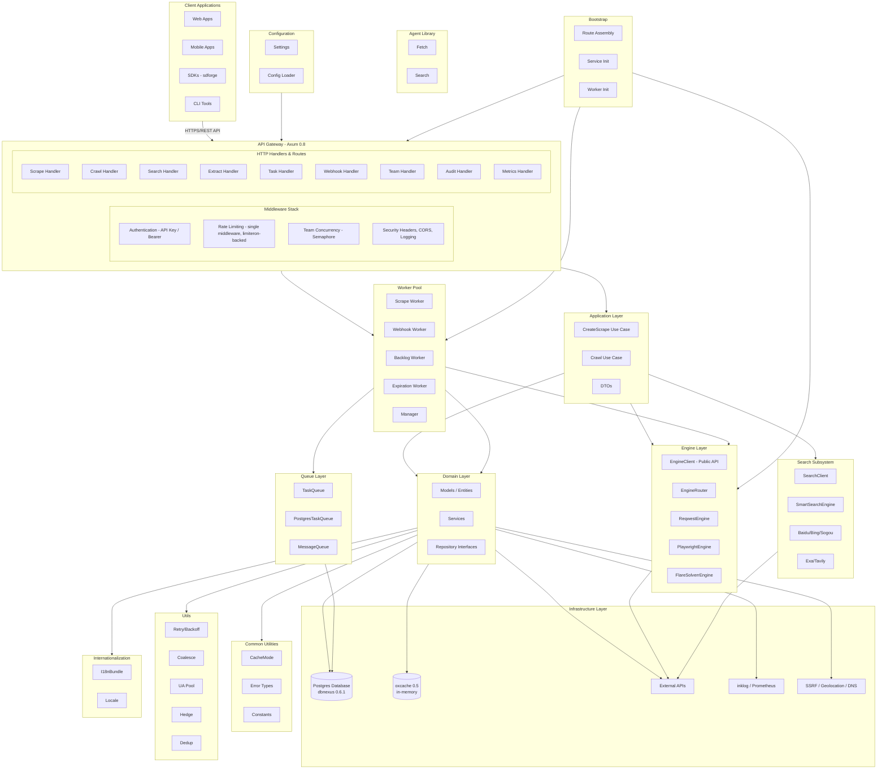
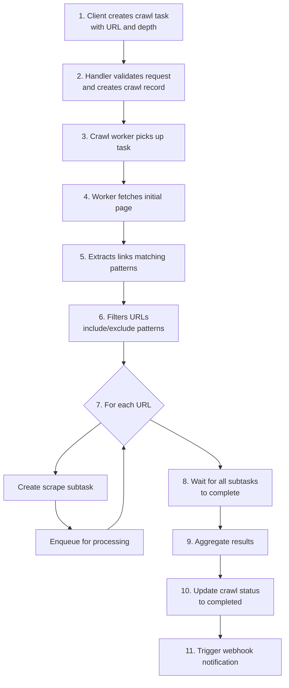
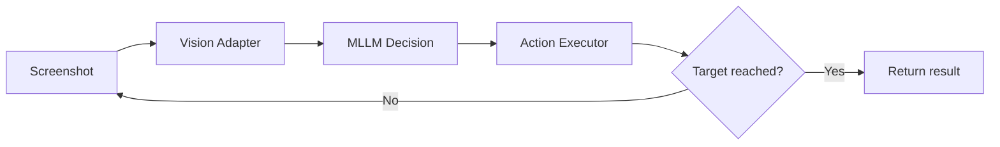
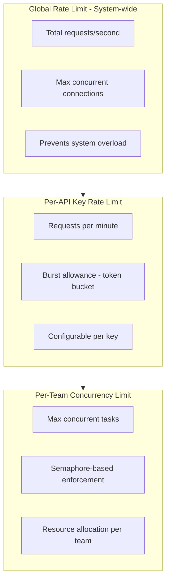
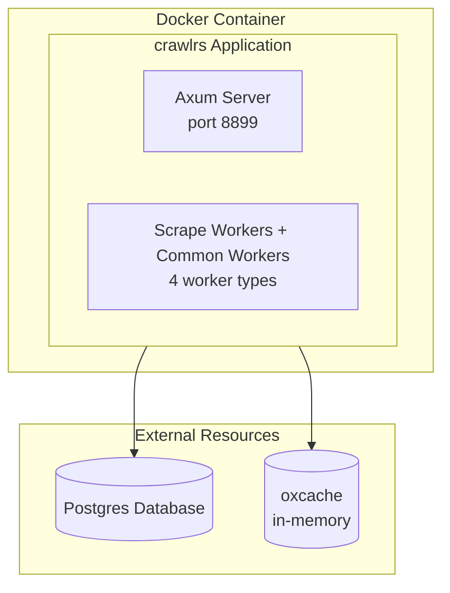
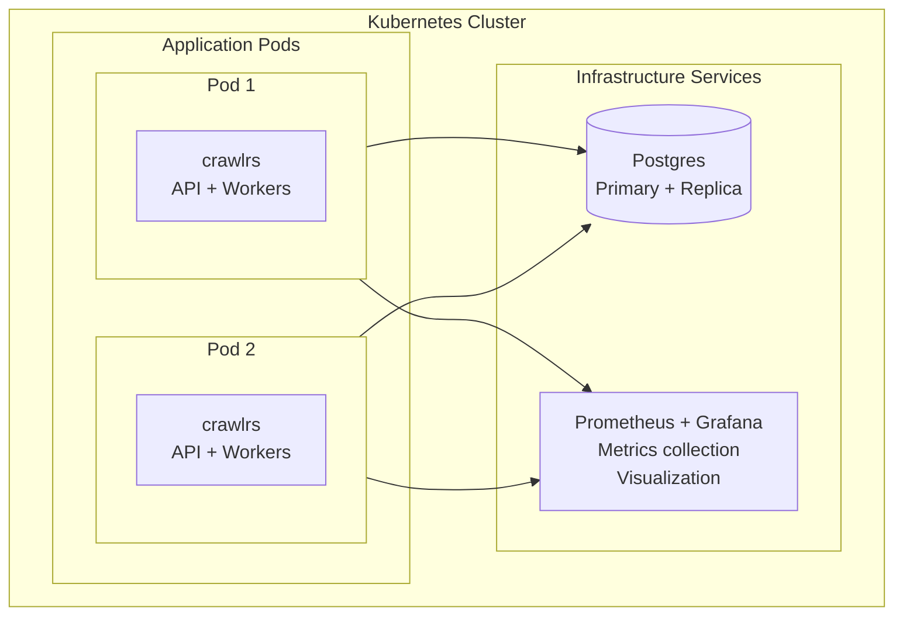
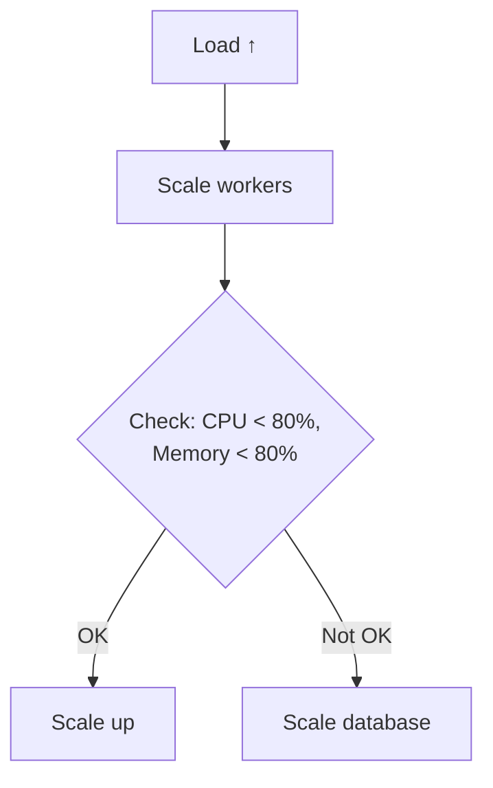

# 🏗️ Crawlrs Architecture

<div align="center">


**Version:** 0.2.0 | **Last Updated:** 2026-11-15 | **Author:** Kirky.X

</div>

---

## 📋 Table of Contents

- [🧭 Overview](#-overview)
- [📐 Architectural Principles](#-architectural-principles)
- [🖥️ System Architecture](#️-system-architecture)
- [🧱 Layer Architecture](#-layer-architecture)
- [🧩 Core Components](#-core-components)
  - [Feature Gate Architecture](#feature-gate-architecture)
- [🔄 Data Flow](#-data-flow)
- [🕷️ Crawling Engines](#️-crawling-engines)
- [🚀 Crawl Capability Enhancement Modules](#-crawl-capability-enhancement-modules)
- [📬 Queue System](#-queue-system)
- [💾 Caching Strategy](#-caching-strategy)
- [⏱️ Rate Limiting](#️-rate-limiting)
- [🔁 In-House Library Reverse Requirements](#-in-house-library-reverse-requirements)
- [🔒 Security Model](#-security-model)
- [🚢 Deployment Architecture](#-deployment-architecture)
- [📈 Scalability Considerations](#-scalability-considerations)
- [🔮 Future Enhancements](#-future-enhancements)
- [📚 Documentation](#-documentation)
---

## 🧭 Overview

crawlrs is built using **Domain-Driven Design (DDD)** principles with a clean, layered architecture. The system is designed for high performance, scalability, and maintainability.

### Key Design Goals

1. **Performance** - 3-5x higher throughput than Node.js alternatives (design goal, not validated by authoritative measurement — see [PERFORMANCE.md](PERFORMANCE.md))
2. **Scalability** - Horizontal scaling capabilities via stateless workers
3. **Type Safety** - Leverage Rust's type system for compile-time safety
4. **Flexibility** - Trait-based architecture for engines and extensions
5. **Observability** - Built-in metrics and inklog 0.3 structured logging via the `log::` facade

### Technology Stack

| Component | Technology | Version |
|-----------|-----------|---------|
| Async Runtime | Tokio | 1.54 |
| Web Framework | Axum | 0.8 |
| ORM | Sea-ORM (via dbnexus) | 2.0.4 |
| HTTP Client | Reqwest | 0.13 |
| Database | PostgreSQL | 16+ |
| Cache | oxcache (in-memory) | 0.5 |
| Rate Limiting | limiteron | 0.3 |
| DI Framework | trait-kit | 0.5 |
| Config | confers | 0.6 |
| SDK Generator | sdforge | 0.5 |
| Logging | inklog | 0.3 |
| Browser Engine | chromiumoxide | 0.9 |
| HTML Parser | scraper | 0.29 |

---

## 📐 Architectural Principles

### 1. Separation of Concerns

Each layer has a specific responsibility:
- **Presentation** - HTTP request/response handling, middleware
- **Application** - Use cases and business workflows, DTO mapping
- **Domain** - Core business logic and entities, repository interfaces
- **Infrastructure** - External integrations, database, cache, security

### 2. Dependency Inversion

High-level modules depend on abstractions (traits), not concrete implementations:

```rust
// Domain defines interface
trait TaskRepository: Send + Sync {
    async fn create(&self, task: &Task) -> Result<Task>;
    async fn find_by_id(&self, id: crate::domain::id::Id) -> Result<Option<Task>>;
    async fn acquire_next(&self, worker_id: crate::domain::id::Id) -> Result<Option<Task>>;
}

// Infrastructure provides implementation
struct TaskRepoImpl {
    db: Arc<DbPool>,
}

impl TaskRepository for TaskRepoImpl { ... }
```

### 3. Single Responsibility

Each component has one reason to change:
- `scrape_worker` - Only handles scrape task execution
- `webhook_worker` - Only handles webhook delivery
- `backlog_worker` - Only handles expired task cleanup
- `LimiteronService` - Only manages rate limits

### 4. Open/Closed Principle

System is open for extension, closed for modification:
- Add new scraping engines by implementing `ScraperEngine` trait
- Add new search engines by implementing `SearchEngine` trait
- Add new middleware by implementing `tower::Layer`

---

## 🖥️ System Architecture



---

## 🧱 Layer Architecture

### Presentation Layer

**Location:** `src/presentation/`

**Responsibilities:**
- HTTP request/response handling
- Request validation
- Response formatting
- Middleware implementation (auth, rate limiting, security)

**Components:**

```
presentation/
├── handlers/              # HTTP endpoint handlers
│   ├── scrape_handler.rs
│   ├── scrape_commands.rs
│   ├── scrape_queries.rs
│   ├── crawl_handler.rs
│   ├── crawl_commands.rs
│   ├── crawl_queries.rs
│   ├── search_handler.rs
│   ├── extract_handler.rs
│   ├── task_handler.rs
│   ├── task_commands.rs
│   ├── task_queries.rs
│   ├── webhook_handler.rs       #[cfg(feature = "webhook")]
│   ├── team_handler.rs          #[cfg(feature = "teams")]
│   ├── audit_handler.rs
│   ├── metrics_handler.rs
│   ├── api_key_handler.rs       #[cfg(feature = "auth")]
│   ├── map_handler.rs           #[cfg(feature = "sitemap")]
│   ├── response_builder.rs
│   └── mod.rs
├── forge_api/             # sdforge inventory registration surface (always compiled)
│   ├── mod.rs
│   ├── crawl.rs
│   ├── management.rs
│   ├── map.rs
│   ├── scrape.rs
│   ├── search.rs
│   └── task.rs
├── routes/                # Handler organization and unit-test assembly; route assembly in `src/bootstrap/routes.rs`
│   ├── mod.rs             # health, version, base routes
│   ├── handlers.rs        # Handler route registration
│   ├── scrape.rs
│   ├── crawl.rs
│   ├── extract.rs
│   └── task.rs
├── middleware/             # HTTP middleware
│   ├── auth_middleware.rs
│   ├── auth_bridge.rs
│   ├── auth_types.rs
│   ├── rate_limit_middleware.rs          # the only rate-limit middleware (delegates to limiteron via the RateLimitingService trait)
│   ├── security_headers_middleware.rs
│   ├── team_semaphore_middleware.rs
│   ├── scope_validation.rs
│   └── mod.rs
├── sdk/                   # sdforge SDK interface
│   ├── mod.rs
│   ├── mocks.rs
│   └── tests.rs
├── helpers/               # Shared helpers
│   ├── mod.rs
│   └── rate_limit_helper.rs
├── extractors/            # Request extractors
│   ├── mod.rs
│   └── app_deps.rs
├── errors.rs
├── state.rs
└── mod.rs
```

The SSRF validation implementation does not live in the presentation layer: `src/infrastructure/security/ssrf/{mod,error,redirect,static_validator,types}.rs`.

**SDK Interface Layer (sdforge 0.5):**

The presentation layer includes an SDK interface built on **sdforge 0.5**, which wraps domain services as HTTP endpoints via sdforge's `#[forge]` macro. All SDK handlers extract authentication context from `AuthState` (populated by `auth_middleware`), never from the request body.

**Handler Flow:**

Production handlers extract dependencies in two real shapes. `scrape_commands::create_scrape` fetches common dependencies in one shot through the aggregate extractor `CrawlRsDeps` (`src/presentation/extractors/app_deps.rs:43`); geo-restriction and team services are injected as `Extension<Option<..>>` (`None` when teams-off), plus `ConnectInfo` for the client IP used in SSRF auditing:

```rust
pub async fn create_scrape(
    CrawlRsDeps {
        queue,
        settings: _settings,
        task_repo: task_repository,
        rate_limiting_service,
        auth_state,
    }: CrawlRsDeps,
    // None when teams-off (Extension not assembled) — the check is skipped
    Extension(geo_restriction_repo): Extension<Option<Arc<dyn GeoRestrictionRepository>>>,
    Extension(team_service): Extension<Option<Arc<TeamService>>>,
    ConnectInfo(addr): ConnectInfo<SocketAddr>,
    payload: Result<Json<ScrapeRequestDto>, axum::extract::rejection::JsonRejection>,
) -> impl IntoResponse
```

`extract_handler::extract` (`src/presentation/handlers/extract_handler.rs:54`) is one of the few handlers that list `Extension<...>` directly, and its `GR` generic is decided by the route assembly (teams-on assembles `DatabaseGeoRestrictionRepository`; teams-off uses the non-generic form):

```rust
pub async fn extract<GR>(
    Extension(queue): Extension<Arc<dyn TaskQueue>>,
    Extension(_settings): Extension<Arc<Settings>>,
    Extension(task_repository): Extension<Arc<dyn TaskRepository>>,
    Extension(rate_limiting_service): Extension<Arc<dyn RateLimitingService>>,
    Extension(geo_restriction_repo): Extension<Arc<GR>>,
    Extension(team_service): Extension<Arc<TeamService>>,
    Extension(auth_state): Extension<AuthState>,
    ConnectInfo(addr): ConnectInfo<SocketAddr>,
    // ...
) -> impl IntoResponse
```

**Middleware Stack:**

1. **Authentication Middleware** - API key validation, Bearer token, team ID extraction
2. **Security Headers Middleware** - CSP, X-Content-Type-Options, X-Frame-Options
3. **CORS** - Configurable origins via `tower-http`
4. **Rate Limiting** - a single middleware `rate_limit_middleware.rs`: the implementation itself only makes the 429 + `Retry-After` decision and sets headers; actual rate checks and quota deduction are delegated via the `RateLimitingService` trait to `LimiteronService` (limiteron 0.3, PostgreSQL backend). No Redis dependency anywhere in the repo
5. **Team Semaphore Middleware** - Per-team concurrency control
6. **Scope Validation** - API key permission scope checking (not mounted in the production router)

---

### Application Layer

**Location:** `src/application/`

**Responsibilities:**
- Use case orchestration
- DTO definitions and transformations
- Business workflow coordination

**Components:**

```
application/
├── use_cases/             # Business use cases
│   ├── mod.rs
│   ├── create_scrape.rs
│   ├── crawl_use_case.rs
│   ├── crawl_link_processor.rs
│   ├── crawl_state_machine.rs
│   └── map_use_case.rs
└── dto/                   # Data Transfer Objects
    ├── mod.rs
    ├── scrape_request.rs
    ├── scrape_response.rs
    ├── crawl_request.rs
    ├── extract_request.rs
    ├── search_request.rs
    ├── task_query_request.rs
    ├── webhook_request.rs
    ├── geo_restriction_request.rs
    └── map_request.rs
```

**Use Case Pattern:**

```rust
pub struct CreateScrapeUseCase<R, Q, C> {
    task_repo: Arc<R>,
    queue: Arc<Q>,
    cache: Arc<C>,
}

impl<R, Q, C> CreateScrapeUseCase<R, Q, C>
where
    R: TaskRepository + Send + Sync,
    Q: TaskQueue + Send + Sync,
    C: CacheClient + Send + Sync,
{
    pub async fn execute(&self, request: ScrapeRequestDto) -> Result<ScrapeResponseDto> {
        // 1. Validate request
        // 2. Check rate limits
        // 3. Check cache
        // 4. Create task
        // 5. Enqueue
        // 6. Return response
    }
}
```

---

### Domain Layer

**Location:** `src/domain/`

**Responsibilities:**
- Core business entities
- Business rules and validation
- Repository interfaces (contracts)
- Domain services

**Components:**

```
domain/
├── models/                 # Domain entities
│   ├── mod.rs
│   ├── builders.rs
│   ├── task_domain.rs
│   ├── task_model.rs
│   ├── crawl_model.rs
│   ├── scrape_result_model.rs
│   ├── search_result.rs
│   ├── team_model.rs
│   ├── webhook_model.rs
│   ├── credits_model.rs
│   └── validations.rs
├── repositories/           # Repository interfaces
│   ├── mod.rs
│   ├── task_repository.rs
│   ├── crawl_repository.rs
│   ├── scrape_result_repository.rs
│   ├── webhook_repository.rs
│   ├── webhook_event_repository.rs
│   ├── team_repository.rs
│   ├── credits_repository.rs
│   ├── geo_restriction_repository.rs
│   ├── audit_log_repository.rs
│   └── tasks_backlog_repository.rs
├── services/               # Domain services
│   ├── mod.rs
│   ├── rate_limiting_service.rs
│   ├── extraction_service.rs
│   ├── extraction_utils.rs
│   ├── team_service.rs
│   ├── team_service_test.rs          # inline tests (same file as the implementation)
│   ├── team_semaphore.rs
│   ├── search_service.rs
│   ├── webhook_service.rs
│   ├── webhook_sender.rs
│   ├── webhook_event_builder.rs
│   ├── noop_webhook_service.rs
│   ├── audit_service.rs
│   ├── audit_log_builder.rs
│   ├── geo_location.rs
│   ├── id_service.rs                 # NebulaId ID generation service
│   ├── rag_strategy.rs               # RAG semantic chunking + vector-retrieval extraction
│   ├── rerank.rs                     # reranking strategy
│   ├── llm/                       # LLM boundary (mod: trait + ExplicitErrorCarrier;
│   │                              #  prompt_builder, chunker, provenance;
│   │                              #  vision_adapter gated by engine-mllm)
│   ├── content_extractor/         # content extraction (trafilatura/dom_smoothie/css_rule/quality_gate/facade)
│   ├── markdown/                 # converter assembly (alchemize_converter default + htmd diagnostic arm)
│   ├── markdown_service.rs
│   ├── relevance_scorer.rs
│   ├── retry_handler.rs
│   ├── webhook/                  # Webhook management/domain logic (management, mod)
│   └── tests/                    # standalone test directory for domain services
├── id/                     # NebulaId domain ID types (Id / IdGenerator)
├── auth/                   # Authentication models
│   ├── mod.rs
│   └── scope.rs
├── errors.rs
├── use_cases/              # Domain use cases
│   ├── mod.rs
│   └── create_webhook.rs
├── retention_policy.rs     # Data retention policy definitions
```

**Core Domain Entities:**

**Task Entity:**
```rust
pub struct Task {
    pub id: crate::domain::id::Id,
    pub team_id: crate::domain::id::Id,
    pub api_key_id: crate::domain::id::Id,
    pub task_type: TaskType,
    pub status: TaskStatus,
    pub priority: i32,
    pub url: String,
    pub payload: Value,
    pub retry_count: i32,
    pub attempt_count: i32,
    pub max_retries: i32,
    pub scheduled_at: Option<DateTime<Utc>>,
    pub expires_at: Option<DateTime<Utc>>,
    pub created_at: DateTime<Utc>,
    pub started_at: Option<DateTime<Utc>>,
    pub completed_at: Option<DateTime<Utc>>,
    pub crawl_id: Option<crate::domain::id::Id>,
    pub updated_at: DateTime<Utc>,
    pub lock_token: Option<crate::domain::id::Id>,
    pub lock_expires_at: Option<DateTime<Utc>>,
}
```

All ID fields are `crate::domain::id::Id` (the NebulaId domain ID type, `src/domain/id/`), not legacy UUID values.

**Task Types:**
- `Scrape` - Single page scrape
- `Crawl` - Multi-page crawl
- `Extract` - Data extraction

**Task Statuses** (`src/domain/models/task_domain.rs:67-79`, five states):
- `queued` - Created, waiting for worker
- `active` - Being processed by worker (not `running`)
- `completed` - Successfully completed
- `failed` - Failed with error
- `cancelled` - Cancelled by user

Note: there are no `Running` or `Expired` variants. Task expiration does not change the status value; it is handled by the `expires_at` field + periodic cleanup via `TaskRepository::expire_tasks()`. `Expired` exists only as a `TasksBacklogStatus` of `tasks_backlog` (the state machine of the refill queue — a separate enum from `tasks.status`).

---

### Infrastructure Layer

**Location:** `src/infrastructure/`

**Responsibilities:**
- External service implementations
- Database access (via dbnexus + Sea-ORM)
- Cache management (oxcache)
- Security (SSRF validation, API key hashing)
- DNS resolution and caching
- Geolocation
- Metrics and observability

**Components:**

```
infrastructure/
├── database/               # Database layer
│   ├── mod.rs
│   ├── dbnexus_connection.rs
│   ├── id_sea_orm.rs
│   ├── query_monitor.rs
│   ├── transaction.rs
│   ├── entities/           # Sea-ORM entity models
│   │   ├── mod.rs
│   │   ├── api_key.rs
│   │   ├── crawl.rs
│   │   ├── credits.rs
│   │   ├── credits_transactions.rs
│   │   ├── geo_restriction_log.rs
│   │   ├── scrape_result.rs
│   │   ├── sea_orm_active_enums.rs
│   │   ├── task.rs
│   │   ├── tasks_backlog.rs
│   │   ├── team.rs
│   │   ├── webhook.rs
│   │   ├── webhook_event.rs
│   │   └── auth/
│   │       ├── mod.rs
│   │       ├── audit_log.rs
│   │       └── scope.rs
│   └── repositories/       # Repository implementations
│       ├── mod.rs
│       ├── macros.rs
│       ├── task_repo_impl.rs
│       ├── crawl_repo_impl.rs
│       ├── scrape_result_repo_impl.rs
│       ├── credits_repo_impl.rs
│       ├── webhook_repo_impl.rs
│       ├── webhook_event_repo_impl.rs
│       ├── database_geo_restriction_repo.rs
│       ├── audit_log_repo_impl.rs
│       ├── tasks_backlog_repo_impl.rs
│       └── tests/               # Repository tests
│           ├── geo_restriction_cleanup_test.rs
│           ├── scrape_result_cleanup_test.rs
│           ├── task_repo_test.rs
│           └── webhook_event_cleanup_test.rs
├── oxcache/                # Unified cache (oxcache-backed)
│   ├── mod.rs
│   └── cache_service.rs
├── security/               # Security implementations
│   ├── mod.rs
│   ├── api_key_hash.rs
│   ├── constant_time_compare.rs
│   ├── env_var_security.rs
│   ├── env_injection.rs
│   ├── env_validation.rs
│   ├── secure_ip.rs
│   └── ssrf/               # SSRF validation (mod, error, redirect, static_validator, types)
├── auth/                   # garrison authentication engine DAO integration
│   ├── mod.rs              # garrison_config / garrison_dao / garrison_interface / garrison_listener
├── events/                 # in-process event bus
│   ├── mod.rs
│   ├── event_bus.rs        # EventBus trait
│   └── broadcast.rs        # BroadcastEventBus (tokio::sync::broadcast implementation)
├── persistence/            # Domain <-> DB entity mappers
│   ├── mod.rs
│   └── mappers/
│       ├── mod.rs
│       ├── task_mapper.rs
│       ├── crawl_mapper.rs
│       ├── credits_mapper.rs
│       └── webhook_mapper.rs
├── services/               # Infrastructure services
│   ├── mod.rs
│   ├── config_service.rs
│   ├── limiteron_service.rs
│   ├── noop_rate_limiting_service.rs
│   ├── http_rerank_provider.rs     # remote rerank HTTP adapter (reqwest only, no feature needed)
│   ├── fluxweir_llm_carrier.rs     # host-injected LLM carrier (T011 retired rag-remote/genai)
│   ├── fluxweir_providers.rs       # embedding/rerank remote fallback (fluxweir unified outlet)
│   ├── vecboost_provider.rs        # rag-local: local embedding/rerank (vecboost)
│   └── webhook_sender_impl.rs
├── dns/                    # DNS resolution + caching
│   ├── mod.rs
│   ├── dns_cache.rs
│   └── ipv4_resolver.rs
├── observability/          # Observability + failure snapshots
│   ├── mod.rs
│   ├── metrics.rs
│   └── failure_snapshot.rs
├── geolocation.rs
├── metrics.rs
├── errors.rs
└── mod.rs
```

**Database Layer:**

**Technology:** dbnexus 0.6.1 (builds on Sea-ORM 2.0.4)

dbnexus provides connection pooling, permission control, migration framework, metrics monitoring, and audit logging on top of Sea-ORM's type-safe database access. Three database backends are supported: PostgreSQL (default), SQLite, and MySQL — selectable via `db-postgres` / `db-sqlite` / `db-mysql` features.

**Key Tables:**

| Table | Purpose |
|-------|---------|
| `tasks` | Task records with locking for worker coordination |
| `tasks_backlog` | Backlog of expired/pending tasks for reprocessing |
| `crawls` | Crawl configurations (depth, patterns) |
| `scrape_results` | Scrape results (raw HTML, markdown, metadata) |
| `api_keys` | ⚠️ PARTIALLY DEPRECATED (0.2.0): the `key_hash`/`scopes` columns are taken over by garrison; only the `id`/`team_id`/`key` columns remain for the `api_key_id→team_id` reverse-lookup mapping (marked with `deprecated_at`) |
| `webhooks` | Webhook configurations (URL, events, retry) |
| `webhook_events` | Webhook event logs and delivery status |
| `audit_logs` | API access and event audit logs (garrison's `audit-log` also writes to this table) |
| `team` | Team accounts and settings |
| `credits` | Team credit balances |
| `credits_transactions` | Credit usage history |
| `geo_restriction_logs` | Geographic restriction check logs |
| `auth_scopes` | ⚠️ DEPRECATED (0.2.0): garrison RBAC took over permission mapping; this table is no longer written (marked with `deprecated_at`, kept read-only for historical audit) |

**Cache Layer:**

**Technology:** oxcache 0.5 (in-memory, no Redis backend)

```rust
// Cache types
pub type SearchCache = Cache<String, Vec<SearchResult>>;
pub type DnsCache = Cache<String, DnsCacheEntry>;
pub type RegexCacheType = Cache<String, String>;
```

oxcache features activated（`Cargo.toml:316`）: `["memory", "serialization", "metrics", "bloom"]`。Type-specific TTL:
- Search cache: configurable (default 60s)
- DNS cache: configurable (default 300s)
- Regex cache: configurable (default 600s)

---

### Additional Top-Level Modules

**Location:** `src/queue/`, `src/search/`, `src/common/`, `src/utils/`, `src/agent_lib/`, `src/i18n/`, `src/config/`, `src/bootstrap/`

```
queue/                     # Task queue abstraction
├── mod.rs
├── message_queue.rs       # Message queue trait + implementations
├── postgres_message_queue.rs  # PostgreSQL-backed message queue
└── task_queue.rs          # TaskQueue trait + PostgresTaskQueue

search/                    # Search subsystem
├── mod.rs
├── client.rs              # SearchClient - multi-engine aggregation
├── client/
│   ├── baidu.rs           # Baidu search engine
│   ├── bing.rs            # Bing search engine
│   ├── exa.rs             # Exa search engine (API)
│   ├── sogou.rs           # Sogou search engine
│   ├── tavily.rs          # Tavily search engine (API)
│   ├── searxng.rs         # SearXNG adapter (public instance JSON API)
│   ├── html_parser.rs     # Shared Google-style HTML parser
│   └── shared_utils.rs    # Shared search utilities
├── dedup.rs               # ResultDeduplicator (SimHash)
├── engine_trait.rs        # SearchEngine trait
├── error.rs               # SearchError types
├── response.rs            # SearchResponse types
├── rrf.rs                 # RRFFuser (k=60)
├── smart/
│   └── mod.rs             # SmartSearchEngine (concurrent aggregation)
└── types.rs               # Search types

common/                    # Shared utilities
├── mod.rs
├── cache_mode.rs          # CacheMode enum + CacheContext
├── constants.rs           # Global constants
├── error.rs               # CrawlRsError types
├── http_method.rs         # HTTP method types
├── masking.rs             # Data masking utilities
├── metrics_shim.rs        # Metrics shim
├── test_fixtures.rs       # Test fixtures
├── test_helpers.rs        # Test helpers
├── text_slice.rs          # Text slice utilities
└── time_utils.rs          # Time utilities

utils/                     # Utility modules
├── mod.rs
├── adaptive_concurrency.rs # AIMD adaptive concurrency
├── backoff.rs              # Full-jitter backoff
├── coalesce.rs            # RequestCoalescer
├── crawl_text_integration.rs # Crawl text integration
├── dedup/
│   ├── mod.rs
│   ├── bloom.rs           # Bloom filter dedup
│   ├── deduplicator.rs    # Deduplicator trait
│   └── interner.rs        # String interner
├── error_helpers.rs       # Error helper utilities
├── glob.rs                # Glob pattern matching
├── hedge.rs               # Hedge request controller (EMA/P84)
├── host_discipline.rs     # Per-host politeness discipline
├── http_client.rs         # HTTP client utilities
├── port_sniffer.rs        # Port detection
├── proxy.rs               # Proxy utilities
├── regex_cache.rs         # Regex cache
├── retry/
│   ├── mod.rs
│   ├── directive.rs       # RetryDirective
│   └── tracker.rs         # RetryTracker
├── retry_after.rs         # Retry-After header parsing
├── retry_policy.rs        # Retry policy
├── robots.rs              # Robots.txt checker
├── search_test.rs         # Search test utilities
├── telemetry.rs            # Telemetry utilities
├── text_processing/
│   ├── mod.rs
│   ├── encoding.rs        # Text encoding
│   └── processor.rs       # Text processor
├── ua_pool.rs             # UA profile pool
├── url.rs                 # URL utilities
└── url_normalizer.rs      # URL normalization

agent_lib/                 # Agent library
├── mod.rs
├── error.rs               # Agent error types
├── fetch.rs               # Agent fetch utilities
└── search.rs              # Agent search utilities

i18n/                      # Internationalization
├── mod.rs
├── bundle.rs              # I18nBundle
├── locale.rs              # Locale handling
├── middleware.rs          # i18n middleware
└── translate.rs           # Translation utilities

config/                    # Configuration
├── mod.rs
├── app.rs                 # App config
├── engines.rs             # Engine config
├── llm.rs                 # LLM config
├── logging.rs             # Logging config
├── rag.rs                 # RAG config
├── runtime.rs             # Runtime config
├── search.rs              # Search config (incl. BingSearchSettings)
├── security.rs            # Security config
├── settings.rs            # Settings struct
└── validation.rs          # Config validation

bootstrap/                 # Application bootstrap
├── mod.rs
├── config/
│   ├── mod.rs
│   ├── config_loader.rs   # Config loading
│   └── config_validator.rs # Config validation
├── engines.rs             # Engine initialization
├── error.rs               # Bootstrap errors
├── infrastructure.rs      # Infrastructure initialization
├── routes.rs              # Route assembly (authoritative)
├── route_groups/
│   ├── mod.rs
│   ├── crawl_routes.rs    # Crawl route group
│   ├── management_routes.rs # Management route group
│   ├── map_routes.rs      # Map route group
│   ├── scrape_routes.rs   # Scrape route group
│   └── search_routes.rs   # Search route group
├── services.rs            # Service initialization
├── telemetry.rs           # Telemetry initialization
└── workers.rs             # Worker initialization
```

---

## 🧩 Core Components

### Dependency Injection (trait-kit 0.5)

DI uses **trait-kit 0.5** with async module builders. `src/main.rs:389-405` registers **9 Modules** into the `AsyncKit`:

| # | Module | Provides |
|---|--------|------|
| 1 | `SettingsModule` | `Arc<Settings>` (including the i18n-resolved configuration) |
| 2 | `DatabaseModule` | dbnexus connection pool, migrations, permissions |
| 3 | `HttpModule` | `Arc<reqwest::Client>` |
| 4 | `CacheModule` | oxcache cache components (search/dns/regex/generic) |
| 5 | `RepositoryModule` | repository components (depends on DatabaseModule) |
| 6 | `EngineModule` | engine vector (5 by default; +MoliEngine when `engine-moli` is enabled) + `EngineRouter` + `EngineClient` (depends on HttpModule, SettingsModule) |
| 7 | `InfrastructureModule` | infrastructure components such as DB pool + cache services |
| 8 | `ServiceModule` | rate-limit/search/webhook/team services + queue + worker |
| 9 | `IdModule` | `IdService` (NebulaId ID generation) |

`EngineModule` provides 5 engine implementations: `ReqwestEngine` / `PlaywrightEngine` / `WreqEngine` (`engine-tls-fingerprint`) / `FlareSolverrEngine` (`engine-flaresolverr`) / `MllmEngine` (`engine-mllm`).

**CrawlRsState** is the runtime state, extracted from the fully built kit by `CrawlRsState::from_kit` (`src/di/axum_state.rs:207`); it requires 5 modules: `InfrastructureModule`, `EngineModule`, `ServiceModule`, `SettingsModule`, `IdModule`. Since v0.2.0 (the `feature-gate-optional-modules` change), 7 fields are gated by `#[cfg(feature = "...")]` and compiled only when the corresponding business feature is enabled:

```rust
#[derive(Clone)]
pub struct CrawlRsState {
    pub db_pool: Arc<DbPool>,
    pub id_service: Arc<IdService>,
    pub task_repo: Arc<dyn TaskRepository>,
    pub credits_repo: Arc<dyn CreditsRepository>,
    pub crawl_repo: Arc<dyn CrawlRepository>,
    pub result_repo: Arc<dyn ScrapeResultRepository>,
    #[cfg(feature = "webhook")]
    pub webhook_repo: Arc<dyn WebhookRepository>,
    #[cfg(feature = "webhook")]
    pub webhook_event_repo: Arc<dyn WebhookEventRepository>,
    pub tasks_backlog_repo: Arc<dyn TasksBacklogRepository>,
    pub task_queue: Arc<dyn TaskQueue>,
    pub rate_limiting_service: Arc<dyn RateLimitingService>,
    #[cfg(feature = "teams")]
    pub team_service: Arc<TeamService>,
    // webhook_service is always compiled (trait); NoopWebhookService is assembled when webhook-off
    pub webhook_service: Arc<dyn WebhookService>,
    pub robots_checker: Arc<dyn RobotsCheckerTrait>,
    pub team_semaphore: Arc<TeamSemaphore>,
    pub request_coalescer: Arc<RequestCoalescer>,
    pub engine_router: Arc<EngineRouter>,
    pub engine_client: Arc<EngineClient>,
    pub create_scrape_use_case: Arc<dyn CreateScrapeUseCaseTrait>,
    pub search_client: Arc<SearchClient>,
    pub search_service: Arc<dyn SearchServiceTrait>,
    // default ExplicitErrorCarrier; the host injects a carrier via pub fields / factory / from_kit
    pub llm_service: Arc<dyn LLMServiceTrait>,
    pub extraction_service: Arc<dyn ExtractionServiceTrait>,
    // RAG: None when rag.enabled=false or unconfigured (an Option, not cfg-gated)
    pub embedding_provider: Option<Arc<dyn EmbeddingProvider>>,
    pub rerank_provider: Option<Arc<dyn RerankProvider>>,
    pub content_extractor: Arc<ContentExtractionFacade>,
    pub cache_service: Arc<dyn CacheService>,
    pub audit_service: Arc<dyn AuditServiceTrait>,
    #[cfg(feature = "webhook")]
    pub webhook_worker: Arc<WebhookWorker>,
    pub backlog_worker: Arc<BacklogWorker>,
    pub expiration_worker: Arc<ExpirationWorker>,
    #[cfg(feature = "teams")]
    pub geo_location_service: Arc<dyn GeoLocationService>,
    #[cfg(feature = "teams")]
    pub geo_restriction_repo: Arc<dyn GeoRestrictionRepository>,
    pub i18n_bundle: Arc<I18nBundle>,
    pub event_bus: Arc<dyn EventBus>,
    #[cfg(feature = "sitemap")]
    pub map_use_case: Arc<MapUseCase>,
}
```

`regex_cache` is no longer on `CrawlRsState` (no such field). The default build (platform, including teams/sitemap) has **36 fields** in total: 29 always compiled + 7 cfg-gated (`webhook_repo`/`webhook_event_repo`/`webhook_worker` gated by `webhook`, `team_service`/`geo_location_service`/`geo_restriction_repo` by `teams`, `map_use_case` by `sitemap`). The field count is authoritative at `src/di/axum_state.rs:70-193`.

| Field | Gated By | Off-mode Behavior |
|-------|----------|-------------------|
| `webhook_repo` / `webhook_event_repo` / `webhook_worker` | `webhook` | Field not compiled; `/v1/webhooks/*` routes not registered; `webhook_worker` spawn block skipped |
| `team_service` / `geo_location_service` / `geo_restriction_repo` | `teams` | Field not compiled; `/v1/teams/*` routes not registered; `extract_handler` signature loses GR generic |
| `map_use_case` | `sitemap` | Field not compiled; `/v1/map` route not registered (streaming sitemap) |
| `webhook_service` | (none, always compiled) | webhook-off: assembled with `NoopWebhookService` (no-op trait impl) |
| `rate_limiting_service` | (none, always compiled) | rate-limit-off: assembled with `NoopRateLimitingService` (always-allow trait impl) |
| `embedding_provider` / `rerank_provider` | (none, `Option`) | `None` when rag is disabled or unconfigured — an Option, not cfg-gated |

See [Feature Gate Architecture](#feature-gate-architecture) for the full gating matrix.

State is injected into Axum handlers via `Extension<CrawlRsState>`.

**Module dependency graph** (the registration order at `src/main.rs:389-405` is the dependency order; `CrawlRsState::from_kit` requires 5 of them):

```text
SettingsModule (Arc<Settings> + i18n configuration)
  ├── DatabaseModule → dbnexus pool (migrations/permissions)
  ├── HttpModule → Arc<reqwest::Client>
  └── CacheModule → oxcache cache components
         ├── RepositoryModule → Repositories (depends on DatabaseModule)
         ├── InfrastructureModule → infrastructure components (DB pool, CacheService, etc.)
         │     └── ServiceModule → ServicesComponents (depends on RepositoryModule, EngineModule)
         ├── EngineModule → EngineComponents (depends on HttpModule, SettingsModule)
         │     └── ServiceModule
         └── IdModule → Arc<IdService> (NebulaId ID generation)
```

`CrawlRsState::from_kit` extracts the components of the five modules `InfrastructureModule`, `EngineModule`, `ServiceModule`, `SettingsModule`, `IdModule` and flattens them into plain fields.

### Feature Gate Architecture

Since v0.2.0 (`feature-gate-optional-modules` change), crawlrs exposes **6 feature axes** that allow operators to build stripped-down binaries for single-tenant / no-auth / no-webhook / no-rate-limit deployments, plus auth-off web assembly and SDK inventory registration. The gating strategy follows two complementary patterns:

1. **Field/module gating** (`#[cfg(feature = "...")]` on `pub mod`/struct field/fn) — gated symbols are **not compiled** when the feature is off, eliminating dead code and reducing binary size.
2. **Noop trait injection** — for traits that business logic calls unconditionally (`WebhookService`, `RateLimitingService`), the trait is always compiled but the DI container assembles a no-op implementation when the feature is off, preserving call-site compatibility.

### Feature Matrix

| Feature | Default | Depends On | Off-mode Behavior |
|---------|---------|------------|-------------------|
| `teams` | on | `auth` | `/v1/teams/*` routes not registered; `extract_handler` loses GR generic + geo-restriction block; `CrawlRsState.{team_service, geo_location_service, geo_restriction_repo}` not compiled; `team_id` falls back to `DEFAULT_TEAM_ID` |
| `auth` | on | `dep:garrison, dep:inventory` | **Since 0.2.0, garrison v0.9 takes over authentication**: `auth_middleware_inner` calls `GarrisonUtil::check_api_key` + `bridge_to_auth_state` to inject `AuthState`; provides RBAC + JWT + firewall-bruteforce (5 failures/60-second window/300-second lockout) + audit-log. When disabled, `default_identity_middleware` injects a fixed `AuthState{team_id=DEFAULT_TEAM_ID, api_key_id=DEFAULT_API_KEY_ID, scope=ApiKeyScope::denied()}` instead — no DB queries, no brute-force protection; protected routes return 401 by default, and allowing them requires an explicit `allow_unauthenticated_protected()` opt-in (the identity remains denied-restricted after opt-in) |
| `rate-limit` | on | — (empty array) | `LimiteronService` replaced by `NoopRateLimitingService` (check_rate_limit→Allowed, check_and_deduct_quota→Ok, get_quota_balance→Ok(i64::MAX), process_backlog_tasks→Ok(0)); `rate-limit` only gates the assembly choice — the `limiteron` crate is always compiled because `utils/backoff` unconditionally depends on its retry primitives, and `rate_limit_middleware` is always mounted (its internal trait calls hit the no-op implementation) |
| `webhook` | on | — | `WebhookServiceImpl`/`WebhookManagementServiceImpl`/`webhook_sender`/`webhook_handler`/`webhook_worker` modules not compiled; `/v1/webhooks/*` routes not registered; `webhook_worker` spawn blocks skipped; `WebhookService` trait preserved and assembled with `NoopWebhookService` (all ops return `Ok(())`) |
| `web-axum` | off | `rate-limit`, `webhook`, `metrics`, `content`, `dbnexus`, `axum` | the auth-off web middleware assembly surface (platform implies auth, which made this path unbuildable in the original matrix); `--no-default-features --features web-axum,db-postgres --lib` builds/tests the auth-off semantics |
| `forge-full` | off | `http` | activates the sdforge inventory registration surface of `presentation/forge_api`; mutually exclusive with the hand-written protected/v2 route groups (coexistence panics at startup) |

### Default feature set

```toml
[features]
default = ["platform", "db-postgres"]
# platform: the full platform service capability surface. sitemap is part of platform (since 0.2.0)
platform = ["teams", "auth", "rate-limit", "webhook", "metrics", "content", "sitemap",
            "dep:dbnexus", "dep:axum", "http"]
teams   = ["auth"]
auth    = ["dep:garrison", "dep:inventory"]   # 0.2.0: garrison v0.9 takes over the authentication engine
rate-limit = []            # empty array: only gates the assembly choice; the limiteron crate is always compiled
webhook = []
full    = ["standard", "engine-flaresolverr", "extractors", "llm"]
llm     = []                # trait + orchestration + ExplicitErrorCarrier, zero external dependencies
engine-mllm = ["engine-playwright", "llm", "gateway"]  # the vision surface is carried by fluxweir chat (genai retired)

# sitemap (merged into platform since 0.2.0):
sitemap = ["dep:quick-xml"]
```

The reason for `rate-limit = []`: the retry primitives of `utils/backoff` unconditionally depend on the `limiteron` crate, so the dependency is not removed when the feature is off; turning the feature off only swaps the `RateLimitingService` assembly from `LimiteronService` to `NoopRateLimitingService`. Likewise `teams` implies `auth`, and `auth` implies `dep:garrison` + `dep:inventory`.

### Gating pattern examples

**Field gating** (`src/di/axum_state.rs`):

```rust
#[cfg(feature = "webhook")]
pub webhook_repo: Arc<dyn WebhookRepository>,
```

**Noop injection** (`src/bootstrap/services.rs::init_rate_limiting_service`):

```rust
#[cfg(feature = "rate-limit")]
{ /* assemble LimiteronService */ }
#[cfg(not(feature = "rate-limit"))]
{
    log::warn!("rate-limit feature disabled, using NoopRateLimitingService");
    Arc::new(NoopRateLimitingService::new())
}
```

**Route gating with shadowing** (`src/bootstrap/routes.rs`):

```rust
#[cfg(feature = "webhook")]
let app = app.route("/v1/webhooks", post(webhook_handler::create_webhook::<WebhookRepoImpl>));
// webhook-off: route not registered, returns 404
```

**Middleware layer gating** (`src/bootstrap/routes.rs`):

```rust
#[cfg(feature = "auth")]
let app = app.layer(axum::middleware::from_fn(auth_middleware::auth_middleware()));
#[cfg(not(feature = "auth"))]
let app = {
    let template = build_default_identity_template(state);
    app.layer(axum::middleware::from_fn_with_state(
        template,
        auth_middleware::default_identity_middleware,
    ))
};
```

### CI verification

The `feature-matrix` job in `.github/workflows/ci.yml` runs `cargo check` against 7 feature combinations to ensure no broken cfg paths slip in:

| Combination | Flags |
|-------------|-------|
| no-default | `--no-default-features` |
| teams-only | `--no-default-features --features teams` |
| auth-only | `--no-default-features --features auth` |
| rate-limit-only | `--no-default-features --features rate-limit` |
| webhook-only | `--no-default-features --features webhook` |
| default | `--features default` |
| full | `--features full` |

### Migration notes

When a feature is off, the corresponding endpoints return **404** (not 401/403) because routes are not registered at startup. Operators switching from full to stripped-down builds should:

- For `auth`-off: pre-provision credits for `DEFAULT_TEAM_ID` via `add_credits` CLI (see `docs/USER_GUIDE.md` → Single-Tenant / No-Auth Deployment)
- For `rate-limit`-off: ensure upstream gateways enforce their own rate limiting
- For `webhook`-off: notify clients that completion callbacks will not be delivered
- For `teams`-off: only `DEFAULT_TEAM_ID` exists; multi-tenant data isolation is enforced at the application layer (all rows owned by `DEFAULT_TEAM_ID`)

### Configuration Hierarchy

**Location:** `config/default.toml` (confers 0.6)

```toml
[database]              # Connection pool, timeouts, prepare-cache
[server]                # Host, port, enable_port_detection
[cors]                  # Allowed origins
[rate_limiting]         # Enabled, default_rpm, burst_size, storage_backend
[cache]                 # Enabled, memory capacity/TTL
[cache.memory]          # Moka L1 capacity + TTL
[cache.types.search]    # Search result cache TTL + max_size
[cache.types.dns]       # DNS cache TTL + max_size
[cache.types.regex]     # Regex cache TTL + max_size
[concurrency]           # Team limits, memory pressure, AIMD
[politeness]            # Per-host min/max interval, AutoThrottle, backoff, jitter
[retention]             # Data retention (scrape_results_days)
[search]                # Timeout, rate limiting, max_results, default_engine
[search.engines]        # Per-engine enable switches (bing/baidu/sogou)
[search.fallback]       # Fallback engine order + API keys
[search.fallback.exa]   # Exa API key + endpoint
[search.fallback.parallel] # Parallel API key + endpoint
[search.fallback.tavily]   # Tavily API key + endpoint
[search.exa]            # Exa single-engine credentials
[search.tavily]         # Tavily single-engine credentials
[search.searxng]        # SearXNG opt-in: enabled/pool_target/max_failover_attempts/seed_urls/user_agent
[search.searxng.collector] # Dataset url/timeouts/min_uptime_day/retire_miss_cycles
[search.searxng.health]    # Probe interval/timeout/query/candidate_batch/failure_retire_threshold
[search.searxng.breaker]   # Per-instance breaker threshold/recovery_timeout_seconds
[engines]               # max_response_body_bytes
[engines.playwright]     # XHR/Fetch capture settings
[engines.flaresolverr]  # FlareSolverr Full mode
[engines.flaresolverr_cdp] # FlareSolverr CDP mode
[engines.flaresolverr_tls] # FlareSolverr TLS mode
[engines.tls_fingerprint]  # Wreq TLS fingerprint (feature-gated)
[engines.mllm]          # MLLM autonomous navigation (feature-gated)
[webhook]               # Secret, max_retries, batch_size
[bing_search]           # Bing Search API key (via env var)
[llm]                   # model, timeout, provenance (vendor access moved to the host carrier)
[llm.chunking]          # Token window chunking settings
[content_extraction]    # Min word count, replacement ratio, prose gates
[rag]                   # Embedding + rerank providers, local/remote settings
[proxy]                 # URLs, strategy, sticky TTL, cooldown
[session]               # Session identity pool (proxy + UA/TLS + cookie)
[workers]               # Count, graceful shutdown, dedup warmup
[sitemap]               # Enabled, max_urls, concurrency, channel capacity
[crawl]                 # Soft 404 fingerprint learning
[timeouts.workers]      # Webhook/backlog intervals
[timeouts.engines]      # Default/playwright/flaresolverr timeouts + MRT
[timeouts.retry]        # Initial/max backoff
[timeouts.cache]        # Default/memory TTL
[logging]               # Console + file output settings
[observability]         # Failure snapshot directory + limits
[trusted_proxies]       # Enabled, proxy IP list (CIDR)
[auth]                  # JWT secret (garrison)
[robots]                # User-agent, scrape respect, fail-closed, cache TTL
[i18n]                  # Default locale, supported locales, locales dir
[id]                    # NebulaId algorithm, workspace, group
```

---

## 🔄 Data Flow

### Scrape Request Flow

```mermaid
flowchart TD
    A[1. Client Request] --> B[2. API Gateway<br/>Authentication<br/>Rate Limit<br/>SSRF Check]
    B --> C[3. Handler<br/>Validation<br/>DTO Mapping]
    C --> D[4. Use Case<br/>Business Logic]
    D --> E[5. Repository<br/>Task Creation]
    E --> F[6. Task Queue<br/>enqueue]
    F --> G[7. Scrape Worker<br/>dequeue + process]
    G --> H{8. Engine Selection}
    H --> H1[ReqwestEngine]
    H --> H2[PlaywrightEngine<br/>(if needs_js)]
    H --> H3[FlareSolverrEngine<br/>(if anti-bot)]
    H1 --> I[9. Result Storage<br/>oxcache + DB]
    H2 --> I
    H3 --> I
    I --> J[10. Task Update<br/>Status = Completed]
    J --> K[11. Webhook Notification<br/>Async]
    K --> L[12. Client Response<br/>Poll/Webhook]
```

### Crawl Request Flow



---

## 🕷️ Crawling Engines

### Engine Architecture

The engine layer is organized around three core abstractions: `ScraperEngine` trait, `EngineRouter` with load balancing, and `EngineClient` as the public API.

**EngineClient** (`src/engines/engine_client.rs`) is the single public entry point for all scraping operations. It encapsulates UA rotation, circuit breaker state, engine selection, and retry logic.

**ScraperEngine Trait:**

```rust
#[async_trait]
pub trait ScraperEngine: Send + Sync {
    async fn scrape(
        &self,
        request: &InternalScrapeRequest,
    ) -> Result<InternalScrapeResponse, EngineError>;

    fn support_score(&self, request: &InternalScrapeRequest) -> u8;

    fn name(&self) -> &'static str;

    fn supports_tls_fingerprint(&self) -> bool {
        false
    }

    fn max_response_time(&self) -> Duration {
        Duration::from_secs(30)
    }
}
```

### Engine Router

The `EngineRouter` (`src/engines/router/mod.rs`, a directory implementation) holds a `Vec<Arc<dyn ScraperEngine>>` and selects engines. The internal strategy field is **hard-coded by default** to `LoadBalancingStrategy::SmartHybrid` in `EngineRouter::new` — there is no settings-side entry to configure it, and the production assembly never calls the setter (setters such as `set_strategy` exist but are used only in tests):

```rust
// src/engines/router/mod.rs:79,86-186
pub enum LoadBalancingStrategy {
    RoundRobin,
    WeightedRoundRobin,
    LeastConnections,
    FastestResponse,
    Random,
    SmartHybrid,  // hard-coded default — not settable via config
}
```

The remaining internal parameters are likewise construction-time constants: `max_engine_attempts = 3`, `max_retries = 5`, `race_mode_enabled = false` (sequential fallback is the default mode; race mode is explicitly enabled), `feature_filter_enabled = true`, `dynamic_threshold_factor = 1.0`.

The `src/engines/router/` directory contains four files: `mod.rs` (router core), `engine_selector.rs` (synchronous candidate-engine filtering), `route_race.rs` (concurrent race), and `route_sequential.rs` (sequential fallback).

The router:
1. Filters engines by `support_score` (feature-based filtering; synchronous filtering in `engine_selector.rs`)
2. Applies the load balancing strategy (`SmartHybrid`, hard-coded at construction)
3. Falls back to sequential engines on failure (`route_sequential.rs`)
4. Supports race mode (concurrent execution, return first success, `route_race.rs`)
5. After race mode wins, calls `hedge_controller.record_latency(response_time)` to update EMA/variance for later P84 threshold estimation (see [Hedge Request-Replica Controller](#hedge-request-replica-controller))
6. (the `engine-moli` feature) after scoring, applies a memory-watermark pre-correction via `apply_memory_policy` (see the next section)

### Engine Matrix and Memory-Watermark Scheduling (engine-moli)

<a id="engine-matrix-and-memory-watermark-scheduling"></a>

Engine capability matrix (`support_score` scale, all GET-only; actions = interaction-action support):

| Engine | feature | needs_js | needs_screenshot | actions | TLS fingerprint | Notes |
|------|---------|----------|------------------|---------|----------|------|
| Reqwest | — | 0 | 0 | 0 | 0 | static scraping baseline |
| Playwright | `engine-playwright` | 100 | 100 | ✅ | 0 | quality baseline; BrowserPool max_instances=5 |
| FlareSolverr (Full/Cdp/Tls) | `engine-flaresolverr` | 60-100 (by mode) | 0-80 | 90 | Tls mode | anti-bot/challenge pages |
| Wreq | `engine-tls-fingerprint` | 0 | 0 | 0 | ✅ | real JA3/JA4 |
| MLLM | `engine-mllm` | visual navigation | ✅ | ✅ | 0 | autonomous navigation |
| Moli | `engine-moli` | 90 | 80 | 0 (not implemented in v1, honestly excluded) | 0 | CDP controls an external `moli serve --layout` (endpoint mode, process owned by the deployer); response-level wait variants return `Unsupported` (its Network event surface is unavailable) |

The memory-watermark scheduler (`src/engines/memory_watermark.rs`, configured via `[engines.memory_scheduler]`): sysinfo periodically samples (default 2000ms) available system memory → three watermark levels (AtomicU8 mirror for lock-free reads):

| Watermark | Determination (default threshold) | EngineRouter behavior | BrowserPool behavior |
|------|------------------|-------------------|------------------|
| Abundant | ≥ 2048 MiB available | original strategy unchanged (Playwright preferred, moli as sequential fallback) | unlimited |
| Tight | < 2048 MiB | moli `support_score` +30 (capped at 255); other scores unchanged | reuse running instances; no total growth (cold pool admits the first instance) |
| Critical | < 512 MiB | browser-family engines drop to 0 (only moli remains to carry JS); without moli, fall back to static scraping per `fallback_to_static` (response marked `js_degraded=true`) or fail fast with `MemoryConstrained` | refuse new acquires + reclaim idle instances in one sweep (reset when the watermark recedes) |

Layered contract: the router is the precise policy (corrects scores on the needs_js dimension), the pool is the coarse safety valve (Critical rejects all + Tight controls capacity) — the two control points intentionally cover different surfaces. Non-`needs_js` requests are unaffected by any watermark. Metrics: `crawlrs_memory_level` (gauge 0/1/2), `crawlrs_engine_policy_overrides_total{engine,level}`.

### Hedge Request-Replica Controller

<a id="hedge-request-replica-controller"></a>

**Location:** `src/utils/hedge.rs`

**Background (design.md §17):** ported from spider's `hedge.rs`; estimates the P84 latency threshold from EMA (exponential moving average) + variance, and suggests sending replica requests above the threshold to cut tail latency.

**Core algorithm:**

- EMA: `EMA_new = α·x + (1-α)·EMA_old`
- Variance: `Var_new = (1-α)·Var_old + α·(x-EMA_new)·(x-EMA_old)` (exponentially weighted moving variance, recursive form)
- P84 threshold: `P84 = EMA + σ_multiplier · sqrt(Var)` (for the standard normal distribution, P84 ≈ μ+σ)

**Concurrency model:** a `parking_lot::Mutex<HedgeState>` guards atomic updates of the `(ema, var, sample_count)` triple. This is not a hot path (a single record after a race win); the Mutex overhead relative to the race's 100ms+ network time is < 0.0001%.

**Integration path:**

```rust
// record latency after EngineRouter::route_race_mode wins
Ok((engine_name, response, response_time)) => {
    self.hedge_controller.record_latency(response_time);
    Ok(response)
}

// the sequential path can call should_hedge in the future to decide replica triggering
if router.hedge_controller().should_hedge(elapsed) {
    // send a replica request...
}
```

**Sample-source limitation (M-2):** `record_latency` is currently called only after a race win, recording the distribution of `min(latency across engines)`. **It cannot be used directly for sequential-path P84 estimation** (the sequential path is a single engine's full latency — a completely different distribution; reusing it would bias the threshold systematically low). Wiring up the sequential path requires its own HedgeController instance.

### WaitFor Strategy

<a id="waitfor-strategy"></a>

**Location:** the enum is defined in `src/engines/engine_client.rs`, implemented in `src/engines/wait.rs` (gated by the `engine-playwright` feature)

**Background (design.md §17):** replaces the original fixed `sync_wait_ms` sleep with conditional waiting: return as soon as the condition holds, error on timeout, and avoid pointless blocking.

```rust
pub enum WaitFor {
    NetworkIdle,           // wait for the network to go idle (no new requests for 500ms)
    Selector(String),      // wait for the given CSS selector to appear in the DOM
    DomStable(Duration),   // wait for the DOM to stabilize (no changes for the given duration, capped at 60s)
}
```

**Integration path:** the `InternalScrapeRequest.wait_for: Option<WaitFor>` field; after `goto`, the Playwright engine calls `request.wait_for.unwrap_or_default().wait(&page, timeout)`.

**Response-level variants (wait-signals, absorbing moli's `--wait-response-*` semantics):** `ResponseUrl(String)` (a response URL matches a regex) and `ResponseBody(String)` (a response body contains a substring; per-body matching checks are capped at 10 MiB). The regex is pre-validated at two layers — the `ScrapeRequest::to_internal` bridge and the `create_scrape` use case — so requests with invalid regexes are never enqueued. Engine support: Playwright listens on the CDP `Network.responseReceived` event stream; moli's Network event surface is verifiably unreachable (`Network.enable` is accepted but yields 0 events) and moli explicitly returns `EngineError::Unsupported` for these variants — they are never silently swallowed.

**Bridge implementation:** the API DTO layer's `ScrapeRequestOptions.wait_for: Option<u64>` (milliseconds) is mapped in the `create_scrape` use case to `WaitFor::DomStable(Duration::from_millis(ms))`, clamped to 10s (the engine-side `WAIT_TIMEOUT_CAP`), preventing valid input from deterministically failing DomStable over budget (`src/application/use_cases/create_scrape.rs:126-130`).

### TabPool Browser Tab Reuse

<a id="tabpool-browser-tab-reuse"></a>

**Location:** `src/engines/client/tab_pool.rs`

**Background (design.md §17):** creating a new Tab per scrape is expensive for the Playwright engine (CDP `Target.createTarget` + `Page.goto`, roughly 50-200ms); TabPool further reuses Pages on top of the BrowserPool, eliminating tab-creation overhead.

**Implementation:** a LIFO lock-free stack based on `DashMap<usize, Page>` + an `AtomicUsize` stack-top pointer:

```rust
pub struct TabPool {
    slots: DashMap<usize, Page>,  // slot index → Page
    head: AtomicUsize,           // monotonically increasing stack-top pointer
    max_size: usize,             // maximum pool capacity
}
```

**acquire/release flow:**

- `acquire(&browser)`: atomically decrements `head` to take the stack-top Page; when the pool is empty, creates one via `browser.new_page("about:blank")`.
- `release(page)`: first navigates the Page to `about:blank` to clean state (5s timeout; on timeout the tab is dropped and closed), then pushes it back; when the pool is full (`head >= max_size`), the Page is dropped directly.

**Multi-Browser safety:** TabPool is not bound to a specific Browser; `acquire` takes a `&Browser` parameter. When the pool is empty, a Page is created with the passed-in Browser; when non-empty, the popped Page may belong to a different Browser. Callers should keep the TabPool lifetime aligned with a single Browser (per-Browser instantiation) or let the upper-layer `BrowserPool` route by instance_id in multi-Browser scenarios.

### Page Action Types

```rust
pub enum PageAction {
    Wait { milliseconds: u64 },
    Click { selector: String },
    Scroll { direction: ScrollDirection },
    Input { selector: String, text: String },
}
```

### Engine Types

#### 1. Reqwest Engine

**Use Cases:**
- Static HTML pages
- API responses
- JSON/XML data
- Fast scraping without JS

**Features:**
- HTTP/2 support via rustls
- TLS 1.2/1.3
- Cookie handling
- Custom headers and proxy support
- Gzip/brotli decompression

**Pros:**
- Fastest performance
- Lowest resource usage
- No browser overhead

**Cons:**
- No JavaScript execution
- Limited dynamic content support

#### 2. Playwright Engine (via chromiumoxide 0.9)

**Use Cases:**
- Single Page Applications (SPAs)
- JavaScript-heavy sites
- Sites requiring interactions
- Screenshots

**Features:**
- Full JavaScript execution via Chrome DevTools Protocol
- Page interactions (click, scroll, input)
- Screenshots
- Network interception

**Pros:**
- Full browser capabilities
- Renders dynamic content
- Can handle complex interactions

**Cons:**
- Higher resource usage
- Slower than HTTP client
- Requires Chromium installation

#### 3. FlareSolverr Engine

FlareSolverr merges the original three fire engines (FlareSolverrEngine, FireEngineCdp, FireEngineTls) into a single engine with mode selection:

```rust
pub enum FlareSolverrMode {
    Full,  // Full mode: JS rendering, session mgmt, CAPTCHA detection, screenshots
    Cdp,   // CDP mode: browser automation, TLS fingerprinting
    Tls,   // TLS mode: TLS fingerprinting only, no screenshots
}
```

All three modes share the same FlareSolverr API client implementation, differing only in `support_score` and `name`:

| Mode | `name()` | `supports_tls_fingerprint()` | Screenshots |
|------|----------|------------------------------|-------------|
| Full | `flaresolverr` | No | Yes |
| Cdp | `flaresolverr_cdp` | Yes | Yes |
| Tls | `flaresolverr_tls` | Yes | Rejected |

**Use Cases:**
- Cloudflare-protected sites
- Anti-bot protected sites
- High-anonymity requirements
- Search engine CAPTCHA bypass

**Features (by mode):**
- Full: JS rendering, session management, CAPTCHA detection
- Cdp: TLS fingerprinting, browser automation, CDP protocol
- Tls: TLS fingerprint adversarial, fast execution, no screenshot

---

### Search Subsystem

**Location:** `src/search/`

**Responsibility layering:**

- **smart layer** (`src/search/smart/mod.rs`): `SmartSearchEngine` concurrent aggregation — `tokio::join!` queries the Baidu/Bing/Sogou engines simultaneously, dedups via SimHash (`ResultDeduplicator`) → RRF fusion (`RRFFuser`, k=60) → scoring/ranking by `RelevanceScorer` (TF-IDF + freshness); per-engine fan-out timeouts degrade as failures (partial results tolerated), and an outbound per-engine minimum-interval gate prevents triggering search-engine bans
- **client layer** (`src/search/client/{baidu,bing,exa,sogou,tavily,searxng}.rs`): the per-engine implementations (HTML parsing, URL extraction, XSS protection, CSS selector management); `html_parser.rs` provides a shared Google-style `HtmlParser` (`once_cell::sync::Lazy` global singleton to avoid recompiling CSS selectors); `searxng.rs` is the public-instance JSON API adapter (instances come from the instance-service port, not directly from the DB)

#### SearXNG Instance Lifecycle

Enabled when `search.searxng.enabled = true` (off by default). The `searxng_instances` registry is the single shared source of truth; the in-process hot pool is just a cache:

```mermaid
flowchart LR
    DS[searx.space<br/>instances.json] -->|collection round<br/>advisory lock against duplicates| C[admission predicate<br/>HTTPS / non-intranet / normal / uptime]
    C -->|idempotent upsert| REG[(searxng_instances)]
    SEED[seed_urls] -->|upsert_seed| REG
    REG -->|candidate/cooldown| PROBE[liveness probe<br/>GET /search?format=json]
    PROBE -->|200 + results[]| POOL[hot pool<br/>target=3]
    PROBE -->|failure| CD[cooldown]
    CD -->|consecutive failures reach threshold| RET[retired]
    POOL -->|search request failure| CB[circuit-break searxng:url]
    CB -->|evict + async promote| PROBE
    POOL --> SE[engine/search path]
```

- **Collection**: periodically fetch `collector.data_url` → lenient serde (all fields optional) → admission predicate → idempotent upsert; `searx_space` instances missing from a dataset accumulate `dataset_miss_count` and flip to `retired` past `retire_miss_cycles` (`seed`-sourced entries are never retired for absence)
- **Liveness probing**: the whole hot pool + `cooldown` entries past their cooldown + the first `candidate_batch` candidates, migrating along the state machine `candidate → active → cooldown → retired` (a `retired` instance that reappears in the dataset and passes probing can return to `active`)
- **Circuit breaking and failover**: a dedicated `CircuitBreaker` instance (key `searxng:<url>`); threshold failures / open circuit → evict + flip to `cooldown` → async probing promotes a substitute back into the pool; a single search swaps at most `max_failover_attempts` instances
- **Degradation scale**: pool full → `Healthy`, non-empty but under target → `Degraded` (+warn), empty → `Unhealthy`; "3 instances" is the control-loop target, not a hard guarantee to external third parties
- **Management API**: `GET /v1/searxng/instances` / `GET /v1/searxng/pool` / `POST /v1/searxng/instances/collect` (auth-protected group, see `src/presentation/handlers/searxng_handler.rs`)

---

## 🚀 Crawl Capability Enhancement Modules

> The following modules were introduced by the `crawler-capability-absorption` change (0.2.0).

### Anti-bot Detection (`src/engines/antibot/`)

A three-tier classifier ported from crawl4ai's `antibot_detector.py`, gated by the `antibot` feature:

- `patterns.rs`: Tier1 (20+ WAF structural markers: Cloudflare/Akamai/PerimeterX/DataDome etc.) + Tier2 (generic-word literal sets, building an `aho_corasick::AhoCorasick`) + Tier3 structural regexes
- `classifier.rs`: the `AntiBotTech` enum + `Detection{tech,reason,needs_browser}` + `classify(status,body,headers,url)->Option<Detection>`
- Router integration: `EngineRouter::route_internal` calls `classify` in the engine-success branch; on a `needs_browser` hit, subsequent attempts are forced to `needs_js=true` and re-routed to a browser engine

### HTTP→Chrome Upgrade Probe (`src/engines/upgrade_probe.rs`)

`JsUpgradeProbe` detects SPA empty shells via strong/weak signal scoring:

- Strong signals (score+=10): `__NUXT_DATA__`/`__NEXT_DATA__`/`window.__INITIAL_STATE__`/empty root + hydration
- Weak signals (score+=1): non-tracking `<script src>` (excluding ga/gtm/analytics/pixel)
- When `score>=threshold`, `EngineRouter` re-routes to Playwright with `needs_js=true`
- Upgrade dead-end degradation: when re-selection with `needs_js=true` finds no engine (no JS-capable engine registered, e.g. an embed form with reqwest only), it degrades to returning the already-fetched raw HTTP response with a `warn!` (including probe score/reason/URL) and accounts it with success semantics (stats/circuit breaker/host discipline/session Cookie capture) — no longer hard-failing with `No suitable engines available` and discarding the response

### Memory-aware Scheduler (`src/workers/scheduler/`)

- `memory_scheduler.rs`: `MemoryState{Normal,Pressure,Critical}` + `MemoryScheduler` reusing `SystemMonitorTrait`; `admit()` returns `Admission::{Proceed,Defer,Reschedule}`
- `priority_queue.rs`: `BinaryHeap<ScheduledTask>` ordered by `effective_priority = base + waited_secs/aging_factor` to prevent starvation
- Wired into `scrape_worker::process_task`: calls `admit()` before acquiring a concurrency permit

### UA Pool (`src/utils/ua_pool.rs`)

`UaProfile{ua,accept_language,sec_ch_ua,platform,viewport,mobile}` + `UaPool{desktop,mobile}`:

- Ships 20+ real desktop + mobile profiles; each profile binds a consistent UA/Accept-Language/sec-ch-ua/viewport
- `pick(mobile)`/`pick_seeded(seed,mobile)`: the same seed returns stably
- Integrated into `ReqwestEngine` (header setting) and `PlaywrightEngine` (UA + viewport setting)

### Smart Retry (`src/utils/retry/` + `src/utils/backoff.rs`)

- `tracker.rs`: `RetryReason{Transient,FeatureToggle,AntiBot}` + `RetryTracker` with independent counts and caps per reason
- `directive.rs`: `RetryDirective{rotate_proxy,rotate_ua,change_viewport,enable_stealth,force_browser}` + `for_attempt(reason,attempt)` escalating progressively
- `backoff.rs`: full-jitter backoff (`cap = min(base*2^attempt, max)`, uniform on `[0, cap]`)
- Integrated into the `scrape_worker` error path: classify the error → compute the directive → check reason-specific caps

### JS Injection (`src/engines/js_inject/`)

Gated by `engine-playwright`:

- `scripts/`: `flatten_shadow_dom.js`/`navigator_overrider.js`/`remove_consent_popups.js`/`remove_overlay_elements.js` (from crawl4ai, embedded via `include_str!`)
- `injector.rs`: `InjectPhase{BeforeLoad,AfterLoad}` + `JsInjector::stealth()`/`cleanup()`/`apply(page,phase)`
- The Playwright engine injects stealth before navigation and cleanup after load

### Request Interception (`src/engines/intercept.rs`)

gated `engine-playwright`，R-jsrender-003：

- Ad/tracking domain blacklist (`AD_DOMAIN_BLACKLIST`): matching requests are aborted via CDP `Fetch.failRequest`
- Optional media-resource interception (`ResourceType::{Image, Media, Font}`): toggled by `ScrapeOptions.block_media`
- Interception counts are observable
- `ScrapeOptions.block_ads` / `ScrapeOptions.block_media` control switches, bridged to the Playwright engine via `InternalScrapeRequest`

### Request Coalescing (`src/utils/coalesce.rs`)

Ported from spider's `coalesce.rs`: `RequestCoalescer{ in_flight: Arc<DashMap<CoalesceKey, InFlightEntry>> }`:

- `CoalesceKey` = tenant (`Task::team_id`) + normalized URL (lowercased scheme/host, fragment stripped, default port stripped) + a structured fingerprint over all `ScrapeOptions` fields (header names lowercased then sorted by name-value; `DefaultHasher` 64-bit, stable within one process)
- `try_start(&CoalesceKey) -> Proceed(CoalesceGuard) | Wait(broadcast::Receiver, leader_task_id)`
- Different tenants or different headers/proxy are never coalesced (M-2: prevents waiters from adopting another tenant's result via the leader task_id)
- `STALE_TIMEOUT=120s` + `purge_stale()`
- Wired into `scrape_worker` via `CoalesceCoordinator`; concurrent requests with the same coalesce key trigger only 1 actual fetch

### AIMD Adaptive Concurrency (`src/utils/adaptive_concurrency.rs`)

Ported from spider's `adaptive_concurrency.rs`:

- `AIMDController`: lock-free `AtomicUsize`; +1 after N consecutive successes, halved on failure (clamped at the min)
- `AdaptiveSemaphore`: bridges `tokio::sync::Semaphore`; `set_target` via `add_permits`/`forget_permits`
- Integrated with `TeamSemaphore::with_adaptive(...)`; disabled by default (`concurrency.adaptive_enabled=false`)

### Markdown Conversion (`src/domain/services/markdown_service.rs` + `markdown/`)

Gated by the `content` feature. **Three-stage pipeline** (after the html2md-converter-chain change):

```text
HTML (static scrape or browser-rendered output)
  → ① extraction chain (`content_extractor/facade.rs`): Trafilatura → DomSmoothie → CSS rules
       (main content trimmed first when only_main_content=true; zero-touch)
  → ② converter (`markdown/`): the alchemize html engine by default (htmd base chain + in-house deep chain,
       with built-in empty-output guarding / honest degradation / math $TeX$ fidelity; [markdown] converter = "alchemize"
       by default; "htmd" as the pass-through diagnostic arm)
  → ③ post-processing (`workers/markdown_post_processor.rs`): only_main_content three-way +
       link absolutization (zero-touch)
```

- Abstraction: the narrow `MarkdownConverter{name,convert}` interface (the assembly point `markdown::build_converter`
  picks the default alchemize arm or the htmd diagnostic arm per `[markdown].converter`; the old
  `MarkdownServiceTrait` was deleted — a one-step switch with no compatibility layer)
- Fallback semantics: built into alchemize (htmd base chain + in-house deep chain; empty-output guarding,
  honest error reporting on double failure, math `$TeX$` fidelity routing); the old `ConverterChain`
  (moli main + htmd fallback) and its `crawlrs_md_converter_fallback_total` metric were removed along
  with the moli-html2md retirement
- Dependencies: `alchemize` (the in-house html engine repo, `html` feature) is a crates.io registry
  dependency (0.1 stable, minor precision); vecboost — needed only by that repo's `audio` feature — is
  brought in by this repo independently as needed (`rag-local`), so a clean checkout resolves without a sibling checkout
- `ScrapeResponse.markdown: Option<String>`; `scrape_worker` generates it via
  the `MarkdownPostProcessor` when formats contains `"markdown"`

**Honest boundary (computed-CSS hooks not wired):** `Dom::control_value` / `has_block_layout` /
`has_text_boundary` keep the trait default implementations (None/false) — static HTML has no computed
styles, and wiring them would produce fake data. A missing `has_block_layout` means "styled links
(such as button-style navigation)" may under-split blocks from the purely structural view, and inline
boundary (tab/badge) folding is weaker than the fully rendered view; a missing `control_value` means
form controls whose value was JS-controlled output the source default.
Reopening condition: after the MoliEngine fully rendered view lands, evaluate through real measurement
whether to provide a computed-style injection surface.

### Content Extraction (`src/domain/services/content_extractor/`)

Gated by `trafilatura`/`dom-smoothie`/`extractors`:

- `traits.rs`: the `ContentExtractor` trait + `ExtractedContent{text,title,author,confidence,page_type}`
- `trafilatura_extractor.rs` (main path) → `dom_smoothie_extractor.rs` (fallback) → `css_rule_extractor.rs` (last resort)
- `facade.rs`: `ContentExtractionFacade` routes by priority; `confidence<0.7` triggers the LLM fallback

### LLM Carrier Boundary (`src/domain/services/llm/`)

- The `LLMServiceTrait` in `mod.rs` is crawlrs's only LLM boundary: `extract_data` / `extract_data_chunked` / `extract_data_with_provenance`, with signatures stable for hosts.
- Vendor access is not self-hosted: `LLMService` / `provider_adapter` / `llm_provider_strategy` were deleted; the vision surface is carried by fluxweir's `FluxweirClient::chat` (`vision_adapter` gated by `engine-mllm`; genai retired).
- Default assembly is `ExplicitErrorCarrier`: without an injected carrier, all three entry points return an i18n bilingual structured error (`domain-error-llm-carrier-not-injected`) — no panic, no silent degradation.
- Three host-injection paths: the `Services.llm_service` pub field, replacing the `init_llm_service` factory, and `CrawlRsState::from_kit`.
- Orchestration tooling is retained: `prompt_builder` / `chunker` (F8) / `provenance` (F9) are public modules for reuse by injected carriers; `[llm]` keeps only `model` / `request_timeout_secs` / `chunking` / `provenance_*`.

### URL Normalization & Layered Dedup (`src/utils/url_normalizer.rs` + `src/utils/dedup/`)

- `url_normalizer.rs`: lowercase host / strip fragment / unify trailing slash / sort query / optional query stripping / `permutations`
- `dedup/bloom.rs` + `dedup/interner.rs`: Bloom⊕Interner layered dedup
- Wired into `scrape_worker::extract_and_queue_links`: Bloom-negative URLs enqueue directly; Bloom-positive ones fall back to exact DB verification

### Proxy Pool (`src/engines/proxy_pool.rs`)

- `ProxyEntry{url,healthy,cooldown,category}` + `ProxyPool` (RR `next(category)` + `sticky(session_id)`+TTL + `mark_failure/success`)
- Implements the `ProxyProvider` trait; `ReqwestEngine` depends on the abstract trait
- `ProxySettings` extends to `urls: Vec<String>` + `strategy` (keeping the single `url` for backward compatibility)

### Advanced Cache Modes (`src/common/cache_mode.rs`)

- `CacheMode{Enabled,Disabled,ReadOnly,Bypass}` + `CacheContext{url,method,mode}` (the old WriteOnly semantics were merged into Bypass)
- `should_read()`/`should_write()`/`is_cacheable()` (data:/blob:/non-idempotent → false)
- `ScrapeOptions.cache_mode: Option<CacheMode>` + DTO `cache_mode`/`bypass_cache` bridging
- `scrape_worker` gates cache reads/writes via `CacheContext`

### Waterfall/MRT Timeout

- `ScraperEngine::max_response_time() -> Duration`: overridden per engine (fetch:5s/playwright:30s/cdp:30s/tls:15s)
- `EngineRouter::route_internal` wraps each engine call with `min(remaining, engine.mrt())`, switching to the next engine when the MRT is exceeded
- The `EngineError::EngineMrtExceeded{engine,mrt}` variant with `is_retryable()=true`

### Deep Crawling (`src/workers/crawl/`)

- `filters.rs`: the `UrlFilter` trait + `FilterChain` + `DomainFilter`/`ContentTypeFilter`/`UrlPatternFilter`
- `scorers.rs`: the `UrlScorer` trait + `CompositeScorer` + `KeywordRelevanceScorer`/`PathDepthScorer`
- `frontier.rs`: `ScoredURL` + `BinaryHeap` priority + domain round-robin
- `adaptive.rs`: `AdaptiveStrategy` (BM25/coverage/saturation) + `StopCondition` (max pages/confidence/saturation/no pending links/KG coverage) + `DrlConfig`
- `knowledge_graph.rs`: `KnowledgeGraphAccumulator` knowledge-graph accumulation + Chao1 coverage estimation + structural-hole detection
- `drl_policy.rs`: `DrlPolicy` ONNX inference + `HeuristicPolicy` heuristic degradation
- `scrape_worker::handle_crawl_success` integrates the `StopCondition` check, terminating the crawl early when triggered

### TLS Fingerprint Engine (`src/engines/client/wreq_engine.rs`)

`WreqEngine` implements TLS fingerprint spoofing on top of the `wreq` crate, mimicking real browsers by customizing the JA3/JA4 fingerprints of the TLS ClientHello.

- **Feature gate**: `engine-tls-fingerprint`
- **Core capability**: custom TLS extension order, cipher suites, and curve lists, producing JA3 fingerprints identical to Chrome/Firefox/Safari
- **Integration path**: registered as a `ScraperEngine` implementation; `support_score` returns 100 when `needs_tls_fingerprint=true`
- **Configuration**: `[engines.tls_fingerprint]` controls the default fingerprint profile and enablement

### MLLM Engine (`src/engines/client/mllm.rs` + `src/engines/mllm/`)

`MllmEngine` implements multimodal LLM autonomous-navigation crawling, using a vision model to understand page content and decide the next action. The engine itself lives in `src/engines/client/mllm.rs` (same layer as the other engines, registered as a `ScraperEngine` implementation); its internal modules live separately under the `src/engines/mllm/` directory:

- `mod.rs` — module assembly
- `ax_tree.rs` — accessibility-tree extraction
- `decision.rs` — action decision
- `action_executor.rs` — click/scroll/type execution
- `config.rs` — configuration

- **Feature gate**: `engine-mllm`
- **Architecture**: Vision Adapter (screenshot → vision model) → Decision (action decision) → Action Executor (executes clicks/scrolls/typing)
- **Agentic Loop**: at most N iterations; each round is screenshot → analyze → act, until the target content is extracted or a termination condition is reached



### RAG-Augmented Extraction (`src/domain/services/rag_strategy.rs`)

Chunks the HTML document along DOM semantic boundaries, finds the most relevant chunks via vector embedding + similarity retrieval, and sends them to the LLM for precise extraction.

- **SemanticChunker**: chunks along DOM boundaries such as `<article>`, `<section>`, `<div>`, `<table>`; tables/lists are never split
- **EmbeddingProvider**: trait abstraction (HTTP API / local model) with oxcache persistence support
- **VectorStore**: in-memory vector store + cosine-similarity top-K retrieval
- **Integration**: `ExtractionServiceTrait::extract_with_rag` as the third extraction mode (alongside CSS/XPath and direct LLM extraction)

### Observability Enhancements (Prometheus Metrics)

5 new Prometheus metrics (`src/infrastructure/observability/metrics.rs`):

| Metric | Type | Labels | Description |
|------|------|------|------|
| `crawlrs_queue_depth` | Gauge | `queue_type` | task queue depth (approximated via AtomicU64) |
| `crawlrs_engine_success_total` | Counter | `engine`, `result` | engine success/failure counts |
| `crawlrs_engine_duration_seconds` | Histogram | `engine` | engine request duration distribution |
| `crawlrs_cache_hit_total` | Counter | `cache_type`, `result` | cache hits/misses (search/dns/regex/generic) |
| `crawlrs_webhook_delivery_total` | Counter | `result`, `status_code` | webhook delivery success/failure |

---

## 📬 Queue System

### Architecture

The queue system uses a **trait-based** approach with a PostgreSQL-backed implementation:

```rust
#[async_trait]
pub trait TaskQueue: Send + Sync {
    async fn enqueue(&self, task: Task) -> Result<Task, QueueError>;
    async fn dequeue(&self, worker_id: crate::domain::id::Id) -> Result<Option<Task>, QueueError>;
    async fn complete(&self, task_id: crate::domain::id::Id) -> Result<(), QueueError>;
    async fn fail(&self, task_id: crate::domain::id::Id) -> Result<(), QueueError>;
    async fn cancel(&self, task_id: crate::domain::id::Id) -> Result<(), QueueError>;
}
```

All IDs are `crate::domain::id::Id` (the NebulaId domain ID), not legacy UUID values.

**PostgresTaskQueue** wraps the `TaskRepository` trait:

```rust
pub struct PostgresTaskQueue {
    pub repository: Arc<dyn TaskRepository>,
}
```

The `TaskRepository` provides `acquire_next(worker_id)` which uses `FOR UPDATE SKIP LOCKED` semantics for safe concurrent worker access. Ordering is `priority ASC, created_at ASC` (smaller values first), supported by the two partial indexes from `migrations/003` (`idx_tasks_acquire_queued` / `idx_tasks_acquire_stale`) for orderly task pickup. See [Queue Architecture](#-queue-system).

### Worker Types

There are actually **4 worker types** running:

| Worker | Purpose | Started by | Driven by |
|--------|---------|--------|----------|
| `scrape_worker` | Process scrape tasks via EngineClient | `manager` (N replicas) | its own `run` loop (not via AbstractWorker) |
| `webhook_worker` | Deliver webhook events to configured URLs | `spawn_common_workers` | the `AbstractWorker` template |
| `backlog_worker` | Reprocess expired/pending tasks | `spawn_common_workers` | the `AbstractWorker` template |
| `expiration_worker` | Expire stale tasks past their TTL | `spawn_common_workers` | the `AbstractWorker` template |

The latter three (webhook/backlog/expiration) are started by `spawn_common_workers` at `src/bootstrap/workers.rs:20-57`, shared between API mode and worker mode, and **do not go through the manager**; scrape_worker is started by the manager. `src/workers/task_state_machine.rs` has zero callers repo-wide (dead code, no runtime wiring).

**Worker template**: `AbstractWorker<P>` drives only the common workers (webhook/backlog/expiration); scrape_worker serves the task queue with its own `run` loop:

```rust
pub struct AbstractWorker<P>
where
    P: WorkerProcess + Send + Sync,
{
    processor: Arc<P>,
    interval: Duration,
}
```

Worker lifecycle:
1. At API/worker process startup, `spawn_common_workers` starts webhook/backlog/expiration; in worker mode the manager additionally starts N scrape_workers
2. Each worker runs its `process()` on a configurable interval
3. Workers share the same TaskRepository for task coordination via `FOR UPDATE SKIP LOCKED`
4. **Graceful shutdown** is coordinated by the `ShutdownCoordinator` (`src/workers/shutdown.rs:35-44`): it embeds trait-kit's `AsyncShutdownCoordinator` for phased shutdown hooks, and `listen_unix_signals` catches SIGTERM/SIGINT to set the shutdown flag; within the grace period (default 30s) workers drain active tasks, and the `ShutdownPhase::DrainQueue` hook triggers `rollback_pending_tasks` to roll unfinished tasks back to `queued` — all visible in `src/main.rs:130-203`. The broadcast channel is used only for RequestCoalescer's same-URL concurrent waiting, not in the shutdown flow

---

## 💾 Caching Strategy

### Architecture

Caching uses **oxcache 0.5** with a single in-memory backend (moka). There is no Redis or multi-tier cache.

```mermaid
flowchart TD
    subgraph L1 [oxcache in-memory (moka)]
        L1Feat1[oxcache::Cache K,V]
        L1Feat2[Configurable capacity & TTL]
        L1Feat3[LRU eviction]
        L1Feat4[Bloom filter]
        L1Feat5[Batch-write]
        L1Feat6[Metrics]
    end

    subgraph Source [Source]
        S1[Actual scraping]
        S2[Database queries]
        S3[DNS resolution]
    end

    L1 -->|"miss"| Source
```

### Cache Types

**Search Result Cache:**
```
search:query:lang=en:country=US:limit=10
TTL: configurable (default 60s)
```

**DNS Cache:**
```
dns:hostname:port
TTL: configurable (default 300s)
```

**Regex Cache:**
```
regex:{hash(pattern)}
TTL: configurable (default 600s)
```

### Cache Service Trait

```rust
#[async_trait]
pub trait CacheService: Send + Sync {
    fn get(&self, key: &str) -> Pin<Box<dyn Future<Output = Result<Option<String>>> + Send + '_>>;
    fn set(&self, key: &str, value: &str, ttl_seconds: u64) -> Pin<Box<dyn Future<Output = Result<()>> + Send + '_>>;
    fn delete(&self, key: &str) -> Pin<Box<dyn Future<Output = Result<()>> + Send + '_>>;
    fn exists(&self, key: &str) -> Pin<Box<dyn Future<Output = Result<bool>> + Send + '_>>;
}
```

### Cache Invalidation

- **Time-based TTL** - Automatic expiration per entry
- **Capacity-based** - LRU eviction when capacity exceeded
- **Bloom filter** - Quick negative existence check before cache lookup

---

## ⏱️ Rate Limiting

**Technology:** limiteron 0.3 (PostgreSQL-backed)

Rate limiting is implemented using **limiteron 0.3**, which provides PostgreSQL-backed token bucket rate limiting with the following features:

| Feature | Purpose |
|---------|---------|
| Token bucket | Per-key rate limiting with refill rate |
| Ban manager | Automatic ban on repeated violations |
| Quota control | Per-team quota management |
| Circuit breaker | Stop-the-world on sustained overload |
| Telemetry | Request tracking and monitoring |
| Parallel checker | High-concurrency rate limit checks |
| Audit log | Rate limit violation logging |

### Middleware Implementation

`src/presentation/middleware/rate_limit_middleware.rs` is the **only** rate-limit middleware. Historically two parallel alternatives coexisted (a historical comment at `src/presentation/middleware/mod.rs:21-24` records that they were removed for having no route mounting point and zero callers); they no longer exist in the code. The middleware itself only makes the 429 decision and sets the `Retry-After` response header; the actual rate check is delegated via the `RateLimitingService` trait to `LimiteronService` (limiteron 0.3, PostgreSQL backend):

```text
HTTP request → rate_limit_middleware (429 + Retry-After)
              → RateLimitingService trait
                ├── rate-limit on:  LimiteronService (PostgreSQL)
                └── rate-limit off: NoopRateLimitingService (always allow)
```

There is no Redis dependency anywhere in the repo, so no cross-instance shared distributed rate-limiting variant exists. The native tower-layer semantics (429/403 + `RateLimit-*` response headers) are provided by limiteron's `tower-middleware`; crawlrs has not wired that in yet.

### Multi-Level Limiting



### Concurrency Control

```rust
pub struct TeamSemaphore {
    permits: Arc<DashMap<crate::domain::id::Id, Arc<tokio::sync::Semaphore>>>,
    max_concurrent: Arc<DashMap<crate::domain::id::Id, usize>>,
}
```

The `TeamSemaphore` enforces per-team concurrency limits. Each team has a dedicated semaphore; the `team_semaphore_middleware` acquires/releases permits per request.

### Limiteron Service

```rust
pub struct LimiteronService {
    governor: Arc<Governor>,
    config: RateLimitingConfig,
    task_repository: Arc<dyn TaskRepository>,
    tasks_backlog_repository: Arc<dyn TasksBacklogRepository>,
    credits_repository: Arc<dyn CreditsRepository>,
}
```

Configured with rules for:
- Default team rate limits
- API key-level rate limits
- Burst allowances

---

## 🔁 In-House Library Reverse Requirements

The in-house library matrix (limiteron / garrison / oxcache / sdforge, same author sharing an rc chain) already carries the fundamentals of authentication, rate limiting, caching, DTO, and more. This section registers the **library-side gaps that remain after crawlrs converged on library capabilities** — each is grounds for a reverse feature request to limiteron / sdforge, with its purpose in this change (`selfdev-lib-adoption-r1`, 2026-10) and the target convergence path. oxcache has no gaps in this change's consumption surface (memory cache + `get_or_with_ttl` built-in single-flight + `BloomFilter`).

### limiteron

| # | Requirement | Current state (transitional) | Purpose / convergence path |
|---|------|---------------|----------------|
| L1 | `KeyedCircuitBreaker`: a manager-level keyed circuit-breaker pool (aligned with the shape of `LimiterManager::get_concurrency_limiter`) | a crawlrs `DashMap<String, Arc<ManualCircuitBreaker>>` thin wrapper (`src/engines/circuit_breaker.rs`); the library only provides a single instance | engine circuit breaking (S6). Once the library ships the keyed pool, delete the crawlrs DashMap layer and fetch through the manager |
| L2 | Sliding-window absolute failure-count mode (aligned with crawlrs's pre-migration semantics) | the library triggers on cumulative ratio (`total >= min_requests` and `failures/total >= 0.5`), which raises sensitivity under mixed traffic (the behavior change is recorded in the CHANGELOG) | engine circuit breaking (S6). Once the library ships the sliding-window mode, restore the per-engine "N failures within the window trips" semantics |
| L3 | Synchronous `try_admit` / state snapshot | a crawlrs `AtomicU8` mirror (record path refreshes asynchronously, selector reads synchronously, `src/engines/circuit_breaker.rs`) | engine_selector synchronous candidate filtering (block_on is forbidden in sync contexts). Once the library provides a synchronous state snapshot, delete the mirror layer |
| L4 | `ConcurrencyLimiter` dynamic resize | crawlrs AIMD keeps its own `AdaptiveSemaphore` outer layer (`src/domain/services/team_semaphore.rs`); the library's manager panics directly on inconsistent parameters for the same key, which is mutually exclusive with dynamic resizing | team-concurrency AIMD (S1). Once the library ships resize, the AIMD branch can be fully pooled |
| L5 | `ConcurrencyLimiter` exposing owned / non-blocking acquisition entry points (`try_acquire` currently exists only in the library's `#[cfg(test)]` private impl) + keyed-pool permits escaping borrows from `&self` | `TeamSemaphore`'s Fixed mode keeps the crawlrs `DashMap + Arc<Semaphore>` implementation (`acquire` returns an owned permit, `try_acquire` returns an `Option` synchronously, zero changes for callers) | team-concurrency Fixed pool (the direct reason S1 judged it non-absorbable). Once the library ships owned/try_acquire, the Fixed branch can sink into the manager's keyed pool |

### sdforge

| # | Requirement | Current state (transitional) | Purpose / convergence path |
|---|------|---------------|----------------|
| S1 | `unified::http_status_for` mapping set extended with 502/504 (BAD_GATEWAY / GATEWAY_TIMEOUT for the corresponding `ApiError` variants) | `CrawlRsError::Network`/`Engine`→502 and `Timeout`→504 remain as three explicit leftover branches (`src/common/error.rs`); the other 14 variants already delegate to the library's mapping table | HTTP status-code mapping (S3). Once the library fills the gap, delete the leftover branches and delegate `status_code` fully |
| S2 | ~~`TranslationStore` supporting fluent resource loading + argument interpolation + a locale→default→key fallback chain~~ (the message layer has converged: queries uniformly go through `sdforge::i18n::translate_for`) | crawlrs `I18nBundle` keeps only locale metadata and negotiation (`locales/*.ftl` embedded at compile time; `src/i18n/catalog.rs` parses lines at startup and registers into the host registry; fluent-bundle retired); the formatting layer (numbers/dates/plurals/collation) has no consumption scenario and `I18nFormatter` was not introduced | error-message i18n (S3). Evaluate the trait-kit `i18n` feature when a formatting scenario appears |

> Convergence discipline: once the library fills a gap, converge a second time per this table (delete the crawlrs thin wrapper/leftover branch) and register it in the corresponding specmark change. This table registers **consumption-surface gaps** only, not internal library defects.

---

## 🔒 Security Model

### Authentication

> **0.2.0 change (`garrison-auth-migration`):** authentication is taken over by garrison v0.9. The old hand-written SHA-256 `api_key_hash` lookup table, `AuthRateLimiter`, and `AuthScopeService` were deleted; the `api_keys.key_hash` / `scopes` tables are marked deprecated (`deprecated_at` column).

**The authentication flow as taken over by garrison:**

1. The client passes a garrison-issued key in the `Authorization: Bearer` header, in the format `garrison_key_id.garrison_secret`
2. `auth_middleware_inner` calls `GarrisonUtil::check_api_key` to verify the key, expiration, status, and RBAC permissions
3. garrison maintains oxcache + its own postgres schema internally, so hits involve no DB round trip
4. `auth_bridge::bridge_to_auth_state` maps the `permissions` returned by garrison to `ApiKeyScope` via `map_perms_to_scope` and injects them into `AuthState`
5. The crawlrs side keeps only the `id`/`team_id`/`key` columns of the `api_keys` table for the `api_key_id→team_id` reverse lookup; that mapping is cached by `TEAM_ID_CACHE` (LRU)

```rust
pub struct AuthState {
    pub pool: Arc<DbPool>,
    pub team_id: crate::domain::id::Id,
    pub api_key_id: crate::domain::id::Id,
    pub scope: ApiKeyScope,
}
```

**401 / 429 are triggered by garrison's `firewall-bruteforce`:**
- Default policy: 5 failures / 60-second window / 300-second lockout
- During lockout all requests return 429 (with a `Retry-After` header)
- The failure count and lockout state are held by garrison's own oxcache

### Garrison Authentication Engine

garrison v0.9 provides five major components; crawlrs depends on them implicitly via the `auth` feature:

| Component | Responsibility | crawlrs integration |
|------|------|------------------|
| **DAO** | its own postgres schema (`garrison_api_keys` / `garrison_roles` / `garrison_permissions` etc.) | migrated by garrison itself; crawlrs is unaware |
| **Interface** | `GarrisonUtil::check_api_key` / `ApiKeyHandler::generate_with_namespace` | called directly by `auth_middleware_inner` and the `POST /v1/admin/api-keys` handler |
| **Config** | RBAC roles / permissions / tenant isolation configuration | garrison ships a preset RBAC (`tenant_id=0`, shared by all teams); API Keys are issued via `POST /v1/admin/api-keys` or bootstrapped at startup with `CRAWLRS__BOOTSTRAP_ADMIN_API_KEY` |
| **RBAC + JWT** | HS256 JWT issuing, role-permission mapping, API Key generation and verification | requires `CRAWLRS__AUTH__JWT_SECRET` (≥32 bytes; startup refuses weak secrets) |
| **firewall-bruteforce** | failure counting, window lockout, IP isolation | 401/429 are returned directly by garrison and passed through by crawlrs |
| **audit-log** | persists authentication events (success / failure / lockout) | written to the crawlrs `audit_logs` table + garrison's own schema |

**Preset RBAC model (`tenant_id=0`, shared by all teams):**

| Permission | role admin | role user | role read_only |
|------|-----------|-----------|----------------|
| `crawlrs:admin` | ✅ | ❌ | ❌ |
| `crawlrs:write` | ✅ | ✅ | ❌ |
| `crawlrs:read` | ✅ | ✅ | ✅ |

`auth_bridge::map_perms_to_scope` maps the permissions above back to `ApiKeyScope` (a deterministic lookup table; admin implies read+write):
- `crawlrs:admin` → `read=true, write=true, admin=true`
- `crawlrs:write` → `write=true`
- `crawlrs:read` → `read=true`

All are constructed via `ApiKeyScope::with_custom_limits` (`DEFAULT_SEARCH_LIMIT=100`, `DEFAULT_SCRAPE_LIMIT=50`) instead of calling `full_access()` — avoiding a conflict between unlimited `u32::MAX` and per-team quota semantics.

### Authorization

**Scope-based Access Control:**

```rust
pub async fn scope_middleware(req: Request<Body>, next: Next) -> Result<Response, StatusCode>
```

`scope_middleware` (`src/presentation/middleware/auth_middleware.rs:487`) reads the `ApiKeyScope` from `AuthState.scope`, calls `determine_required_scope(path, method)` to derive the required `ScopePermission`, and verifies it with `ApiKeyScope::has_permission`. The `ScopePermission` enum: `Read` / `Write` / `Admin` (`src/domain/auth/mod.rs:35`). Note this middleware is not mounted in the production router.

Scopes: `scrape`, `crawl`, `search`, `extract`, `admin`

> **Since 0.2.0:** `AuthState.scope` is bridged from garrison permissions by `auth_bridge::map_perms_to_scope`; the downstream `scope_middleware` is unaware of it.

### Migration Guide (0.2.0 garrison-auth-migration)

**Impact on existing deployments:**

1. **Legacy API Keys invalidated**: all keys in the original `api_keys.key_hash` (SHA-256) are invalid; clients must re-issue through garrison
2. **The `scopes` table is read-only**: the legacy scope mapping no longer applies; new permissions come from garrison RBAC
3. **Required configuration**: `CRAWLRS__AUTH__JWT_SECRET` must be set (HS256, ≥32 bytes); weak secrets refuse to start

**Ops steps:**

Migration is complete. New teams get API Keys issued via `POST /v1/admin/api-keys` with no ops-tooling involvement.
In dev/test environments, admin keys can be issued automatically via the `CRAWLRS__BOOTSTRAP_ADMIN_API_KEY` environment variable.

**Behavior of `migrations/005_deprecate_legacy_api_keys.sql`:**
- Only adds a `deprecated_at` column to the `api_keys` table and backfills `NOW()`
- Only adds a `deprecated_at` column to the `scopes` table and backfills `NOW()`
- Deletes no data and drops no columns, easing rollback and historical audit

### SSRF Protection

SSRF validation occurs at two stages:
1. **Static validation** (synchronous pre-filter) - checks URL scheme, hostname patterns, IP ranges
2. **Full validation** (async with DNS resolution) - resolves hostnames, checks resolved IPs

**Blocked patterns (static validation):**
- `http://localhost:*` (loopback hostnames)
- `http://127.*` (IPv4 loopback)
- `http://10.*` (RFC 1918 class A)
- `http://192.168.*` (RFC 1918 class C)
- `http://172.16-31.*` (RFC 1918 class B)
- `http://[::1]*` (IPv6 loopback)
- `http://[fe80:*` (IPv6 link-local)
- `file://*` and `ftp://*` (non-HTTP schemes)

**Blocked ports:**
- 25 (SMTP), 465 (SMTPS), 587 (SMTP submission)
- 3306 (MySQL), 5432 (PostgreSQL), 6379 (Redis), 27017 (MongoDB)

**DNS rebinding protection:**
- Resolve hostname to IPs at request time
- Validate all resolved IPs against private ranges
- Cache DNS results with configurable TTL

```rust
pub enum SsrfValidationResult {
    Safe(ValidatedUrl),
    Blocked { url: String, reason: String },
    RequiresDnsResolution { url: String, hostname: String },
}
```

### Audit Logging

**Logged Events:**
- API requests (endpoint, method, timestamp, team ID)
- Authentication attempts (success/failure)
- Rate limit violations
- Denied requests (SSRF, invalid key, scope violation)
- Task lifecycle events (created, completed, failed)

---

## 🚢 Deployment Architecture

### Single Instance



### Multi-Instance Deployment (Kubernetes)



### Deployment Components

1. **Application Pods**
   - Each pod runs both API server and worker pool
   - Horizontal Pod Autoscaler (CPU/memory based)
   - Load balancer (Ingress)
   - Health check endpoints: `/health`, `/ready`, `/metrics`

2. **PostgreSQL**
   - Primary + Read replicas
   - Connection pooling via dbnexus
   - Automated backups

3. **Monitoring**
   - Prometheus metrics scraping (via `metrics-exporter-prometheus`)
   - inklog structured logging
   - Grafana dashboards

---

## 📈 Scalability Considerations

### Horizontal Scaling

**Stateless Workers:**
- Workers share no local state
- Task coordination via PostgreSQL `FOR UPDATE SKIP LOCKED`
- No session affinity required

**Shared State:**
- PostgreSQL is the single source of truth
- oxcache is per-instance (in-memory), not shared

### Scaling Strategy



### Bottleneck Identification

| Metric | Action |
|--------|--------|
| Queue depth > 1000 | Scale worker pods |
| Cache hit < 50% | Increase cache size |
| DB query time > 100ms | Add replicas / optimize queries |
| Memory > 80% | Scale vertically or horizontally |
| CPU > 80% | Scale horizontally |

---

## 🔮 Future Enhancements

### Planned Architecture Improvements

1. **Event-Driven Architecture**
   - Event bus for internal communication
   - Webhook event sourcing

2. **WebSocket Support**
   - Real-time task status updates
   - Push notifications (reduced polling)

3. **Redis Cache Layer**
   - Shared cache across instances
   - Replace per-instance oxcache for multi-pod deployments

---

## 📚 Documentation

- [API Reference](API_REFERENCE.md)
- [User Guide](USER_GUIDE.md)

---

**Last Updated:** 2026-09-15
